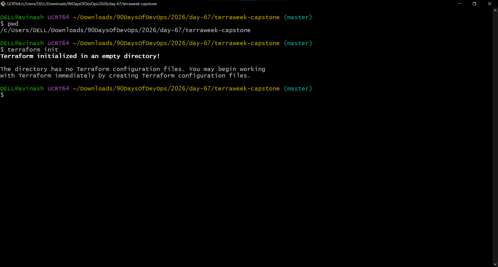
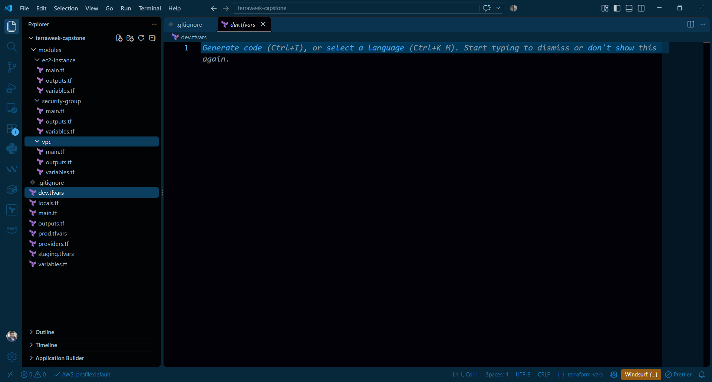
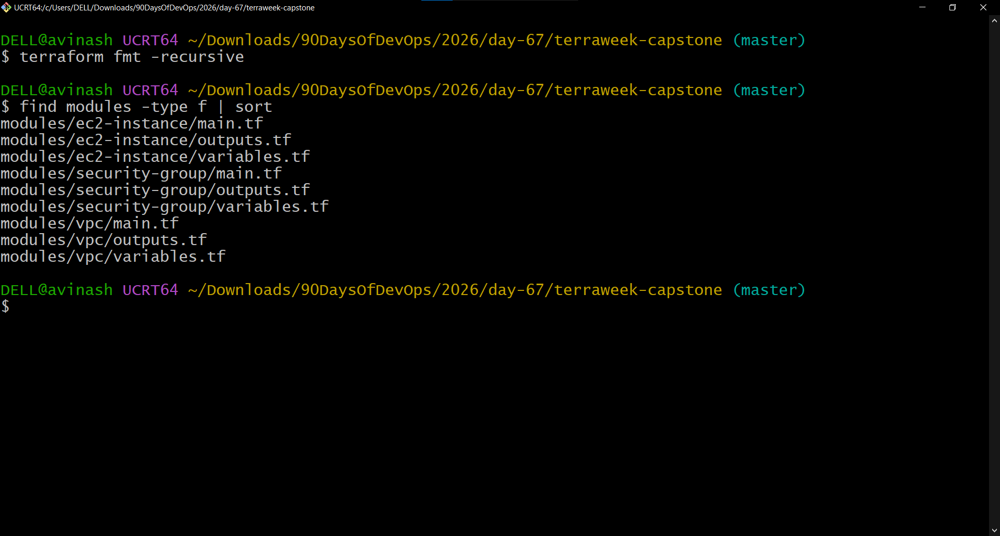
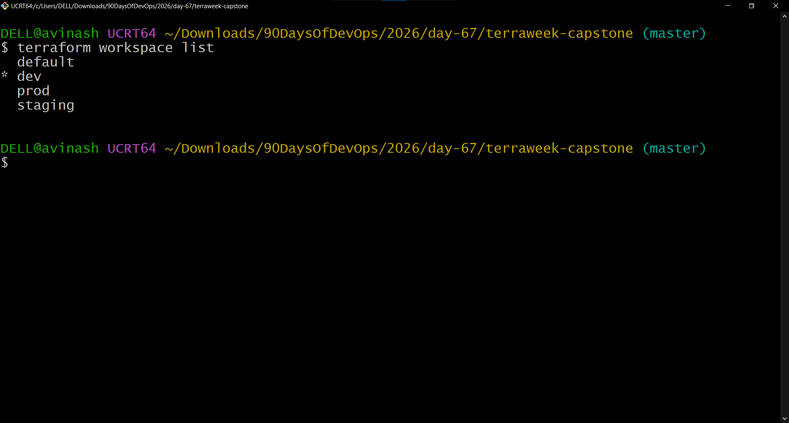
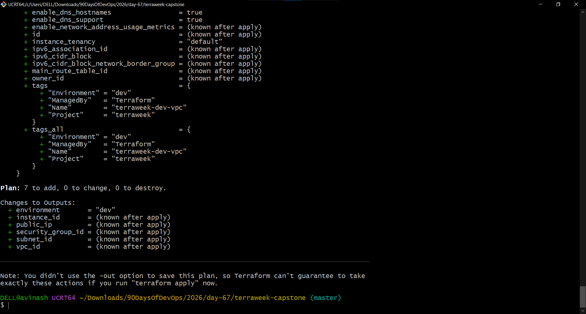
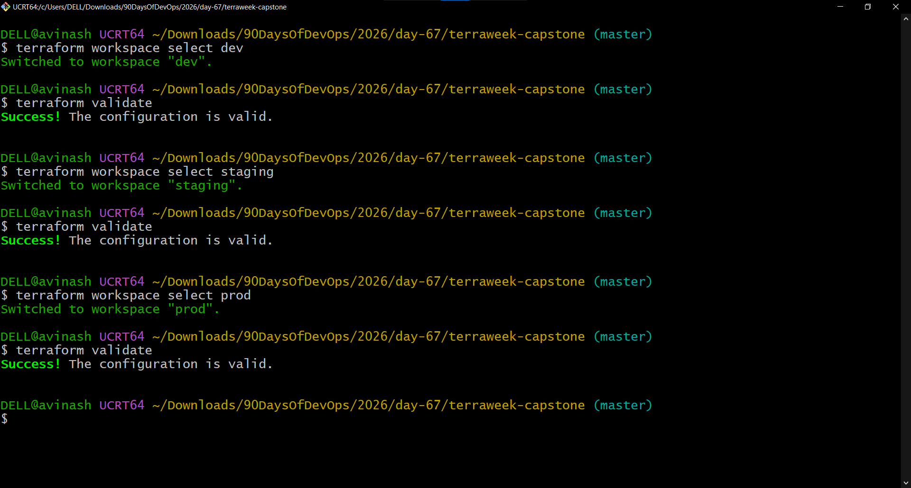
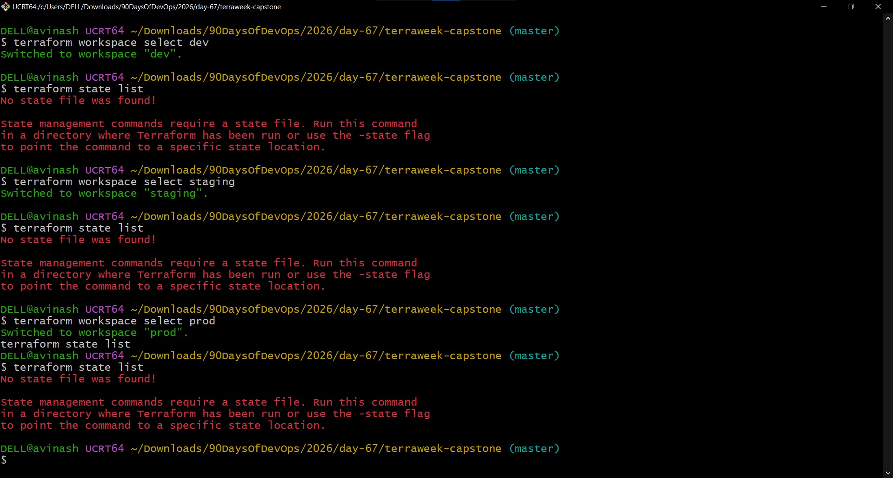
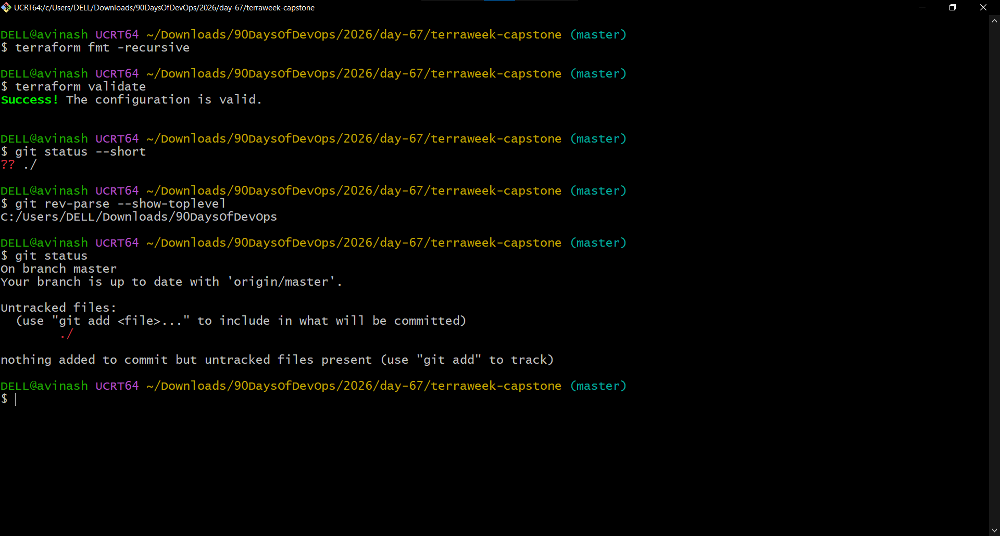
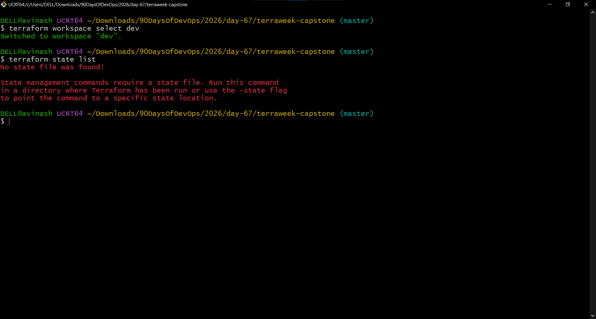
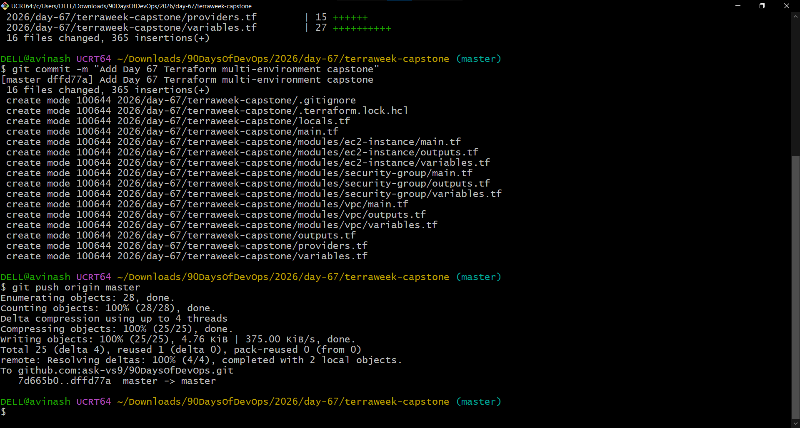

# Day 67 — Terraform Multi-Environment Capstone

## Objective

Build a reusable Terraform configuration using custom modules for a VPC, security group, and EC2 instance. Configure separate `dev`, `staging`, and `prod` environments using Terraform workspaces and environment-specific variable files.

**AWS deployment status:** Configuration was formatted, initialized, validated, and planned. `terraform apply` was not run, so this lab did not create AWS infrastructure through Terraform.

## Project structure

```text
2026/day-67/
├── README.md
├── 01-day-67-project-setup.png
├── 02-day-67-project-structure.png
├── 03-day-67-custom-modules.png
├── 04-day-67-terraform-validation-workspaces.png
├── 05-day-67-dev-terraform-plan.png
├── 06-day-67-environment-validation.png
├── 07-day-67-workspace-state-check.png
├── 08-day-67-final-validation.png
├── 09-day-67-github-push.png
├── 10-day-67-dev-empty-state.png
└── terraweek-capstone/
    ├── .gitignore
    ├── .terraform.lock.hcl
    ├── providers.tf
    ├── variables.tf
    ├── locals.tf
    ├── main.tf
    ├── outputs.tf
    ├── dev.tfvars             # ignored by Git
    ├── staging.tfvars         # ignored by Git
    ├── prod.tfvars            # ignored by Git
    └── modules/
        ├── vpc/
        │   ├── main.tf
        │   ├── variables.tf
        │   └── outputs.tf
        ├── security-group/
        │   ├── main.tf
        │   ├── variables.tf
        │   └── outputs.tf
        └── ec2-instance/
            ├── main.tf
            ├── variables.tf
            └── outputs.tf
```

> Screenshot files are stored in `2026/day-67/`, alongside this documentation. Terraform project files are stored in `2026/day-67/terraweek-capstone/`.

## Tasks completed

### Task 1 — Project setup

Created the `2026/day-67/terraweek-capstone/` project directory for the Terraform capstone.

**Screenshot — Project setup**



### Task 2 — Project structure

Created the root Terraform files and the three module directories.

**Screenshot — Project structure**



### Task 3 — Custom Terraform modules

Created three reusable modules:

- **VPC module:** `modules/vpc/`
- **Security group module:** `modules/security-group/`
- **EC2 instance module:** `modules/ec2-instance/`

Each module contains `main.tf`, `variables.tf`, and `outputs.tf`. Ran recursive Terraform formatting and checked that all nine module files were present.

**Screenshot — Custom Terraform modules**



### Task 4 — Root configuration and workspaces

Configured the root Terraform files:

- `providers.tf` — AWS provider and region configuration.
- `variables.tf` — input variables for project name, CIDR ranges, instance type, and ingress ports.
- `locals.tf` — environment name and common resource tags.
- `main.tf` — connects the VPC, security-group, and EC2 modules, and looks up an Amazon Linux 2023 AMI.
- `outputs.tf` — exposes the environment, VPC, subnet, security group, instance ID, and public IP.

Created and verified the `dev`, `staging`, and `prod` Terraform workspaces. The `default` workspace also remains available.

**Screenshot — Validation and workspaces**



### Task 5 — Environment-specific plans

Configured environment-specific variable files. These local `.tfvars` files are excluded from Git by `.gitignore`.

| Environment | VPC CIDR | Subnet CIDR | Instance type | Ingress ports |
|---|---|---|---|---|
| Dev | `10.0.0.0/16` | `10.0.1.0/24` | `t2.micro` | 80 |
| Staging | `10.1.0.0/16` | `10.1.1.0/24` | `t2.small` | 80, 443 |
| Prod | `10.2.0.0/16` | `10.2.1.0/24` | `t3.small` | 80, 443 |

Reviewed Terraform plans for all three environments. Each plan reported **7 to add, 0 to change, and 0 to destroy**. No plan was applied.

The dev plan was updated to remove SSH port 22 from its ingress ports. Staging and production were configured for HTTP/HTTPS only.

**Screenshot — Dev Terraform plan**



### Task 6 — Validation and state checks

Ran `terraform fmt -recursive` and `terraform validate`. Validation succeeded for the `dev`, `staging`, and `prod` workspaces.

Ran `terraform state list` in each environment. Terraform reported that no state file was found, consistent with not having applied the configuration in these workspaces.

**Screenshots — Validation and state checks**









### Task 7 — Git safety and GitHub push

Configured `.gitignore` to exclude local Terraform data and environment files, including:

```gitignore
.terraform/
*.tfstate
*.tfstate.*
*.tfvars
*.tfplan
*.plan
```

Checked that the `.tfvars` files were ignored, reviewed the staged files, committed the Terraform configuration, and pushed it to the existing `master` branch.

Commit message:

```text
Add Day 67 Terraform multi-environment capstone
```

Commit hash shown in the terminal:

```text
dfffd77
```

**Screenshot — GitHub push**



## Commands used

Run these from the `terraweek-capstone/` directory.

### Format and validate

```bash
terraform fmt -recursive
terraform init
terraform validate
```

### Create and select workspaces

```bash
terraform workspace new dev
terraform workspace new staging
terraform workspace new prod

terraform workspace list
terraform workspace select dev
terraform workspace show
```

If a workspace already exists, use `terraform workspace select <workspace>` rather than creating it again.

### Preview a plan without deploying

```bash
terraform workspace select dev
terraform plan -var-file=dev.tfvars

terraform workspace select staging
terraform plan -var-file=staging.tfvars

terraform workspace select prod
terraform plan -var-file=prod.tfvars
```

`terraform plan` previews proposed changes; it does not apply them.

### Check state

```bash
terraform workspace select dev
terraform state list
```

A missing state file is expected when the configuration has not been applied in that workspace.

## Cost and deployment note

No `terraform apply` was run during this lab. The work completed here was configuration, formatting, initialization, validation, planning, state inspection, and Git operations. These steps did not create the planned VPC, security group, or EC2 instance through Terraform.

The AWS Console was also checked, and no resources were visible there. This is a point-in-time console check, not a guarantee that there are no charges from other resources, regions, services, or previously accrued usage. Check AWS Billing and Cost Explorer for account-level billing information.

## What I learned

- How to structure reusable Terraform modules.
- How to pass variables and outputs between root configuration and modules.
- How to use Terraform workspaces for separate environments.
- How to provide environment-specific values through `.tfvars` files.
- How to format, initialize, validate, and plan Terraform configurations without applying them.
- How to use `.gitignore` to keep Terraform state, plan files, and local environment variables out of Git.
- How to commit and push a Terraform project to GitHub.

## Repository location

The project is located at:

`2026/day-67/terraweek-capstone/`
