# Day 68 – Introduction to Ansible and Inventory Setup

## Overview

This lab introduces Ansible as an agentless configuration-management tool. Ansible runs from a control node and connects to managed Linux servers over SSH.

## Lab Environment

- **Control node:** Ubuntu/WSL terminal
- **Ansible version:** 2.10.8
- **Python version shown by Ansible:** 3.10.12
- **Managed nodes:** Three EC2 instances named `day68-web-server`, `day68-app-server`, and `day68-db-server`
- **AWS Region:** Asia Pacific (Mumbai), `ap-south-1`
- **Inventory aliases:** `web-server`, `app-server`, and `db-server`

Ansible was installed on the control node. The managed nodes did not require an Ansible agent; Ansible connected to them using SSH.

## Ansible Architecture

- **Control node:** The machine where Ansible commands and playbooks are run.
- **Managed nodes:** The remote servers that Ansible configures.
- **Inventory:** The file that lists the managed hosts and groups.
- **Modules:** Units of work such as `ping`, `command`, `copy`, and `uri`.
- **Playbooks:** YAML files that define repeatable tasks for selected hosts.

Ansible sends tasks from the control node to managed nodes over SSH. The nodes do not need a continuously running Ansible agent.

## Task 1 – Understand Ansible

### What is configuration management?

Configuration management keeps servers configured consistently and in the desired state. It helps automate routine administration, reduce manual mistakes, and make changes repeatable.

### Ansible compared with Chef, Puppet, and Salt

Ansible is commonly used without an agent on managed nodes and usually connects over SSH. Chef and Puppet commonly use an agent-based model, while Salt supports agent-based and agentless approaches depending on its configuration. The tools differ in architecture, execution model, and ecosystem.

### What does agentless mean?

Agentless means that a separate Ansible agent does not need to be installed and kept running on each managed node. For Linux hosts, Ansible normally uses SSH and requires suitable credentials and Python support for many modules.

## Task 2 – Lab Setup

Three EC2 instances were visible in the AWS console:

- `day68-web-server`
- `day68-app-server`
- `day68-db-server`

All three were shown as running and using the `t2.micro` instance type in the captured console view.

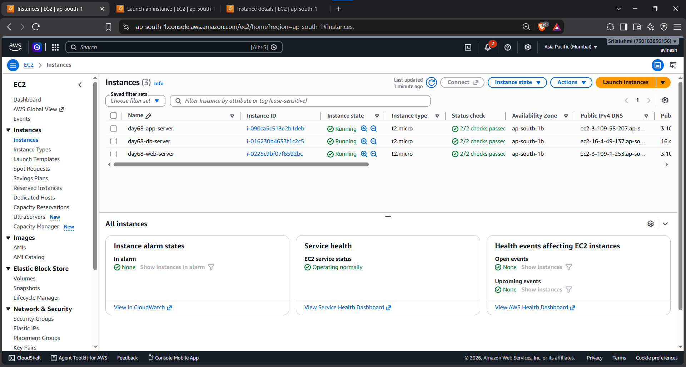

The web-server instance details were also captured:

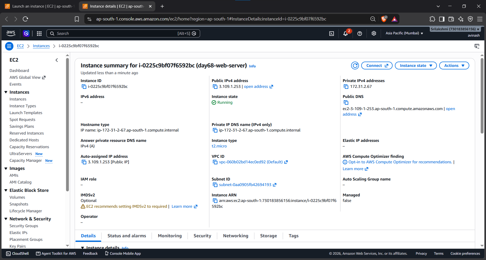

## Task 3 – Install Ansible

The control node reported the following when `ansible --version` was run:

- Ansible: `2.10.8`
- Configuration file: `None`
- Python: `3.10.12`

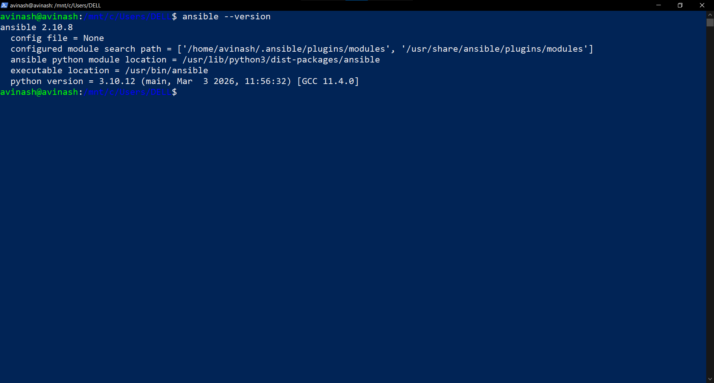

Ansible is installed on the control node because that is where the automation commands are executed. The managed nodes do not need the Ansible package installed.

## Task 4 – Inventory and Connectivity

The working inventory is stored locally as `~/ansible-practice/inventory.ini`. It contains the `web`, `app`, and `db` groups, with aliases `web-server`, `app-server`, and `db-server`.

**Security note:** The local inventory contains connection details. Do not publish private IPs unnecessarily, private-key paths, credentials, or private keys. The private key itself must never be committed to Git.

The command below successfully reached all three hosts:

```bash
ansible all -i inventory.ini -m ping
```

Each host returned `SUCCESS` with `"ping": "pong"`.

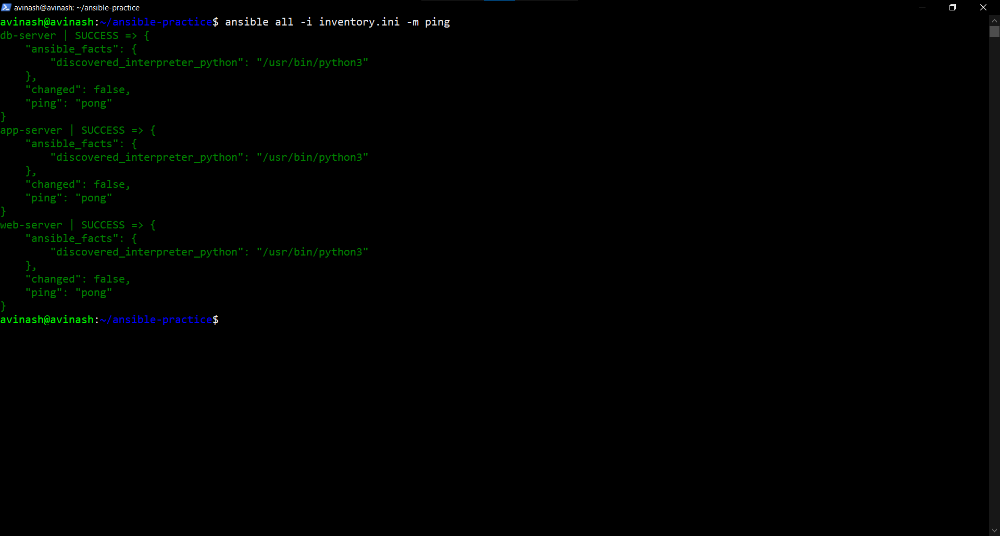

A further captured run also shows successful results for all hosts:

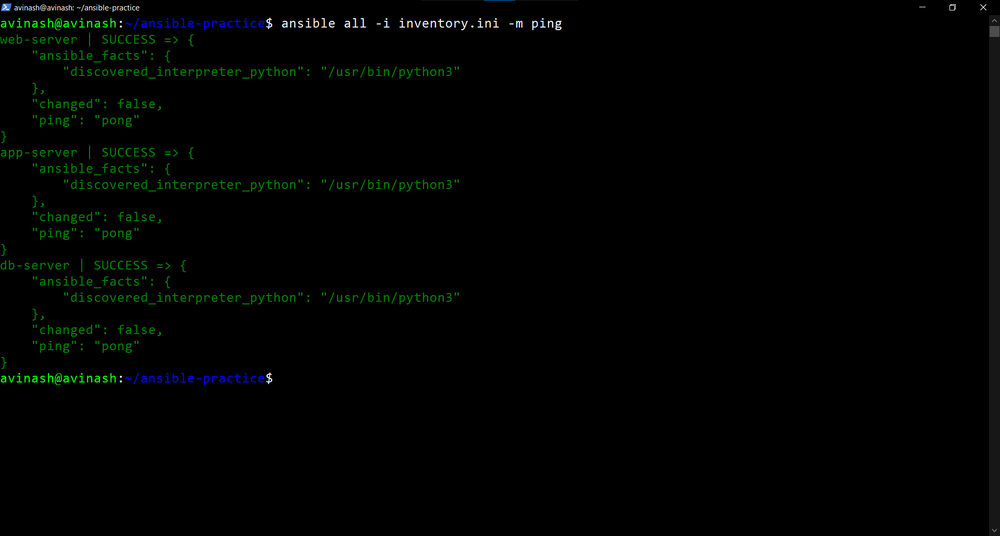

## Task 5 – Ad-Hoc Commands

The following ad-hoc checks were run successfully.

### 1. Check uptime on all servers

```bash
ansible all -i inventory.ini -m command -a "uptime"
```

The output returned uptime and load-average information for `web-server`, `app-server`, and `db-server`.

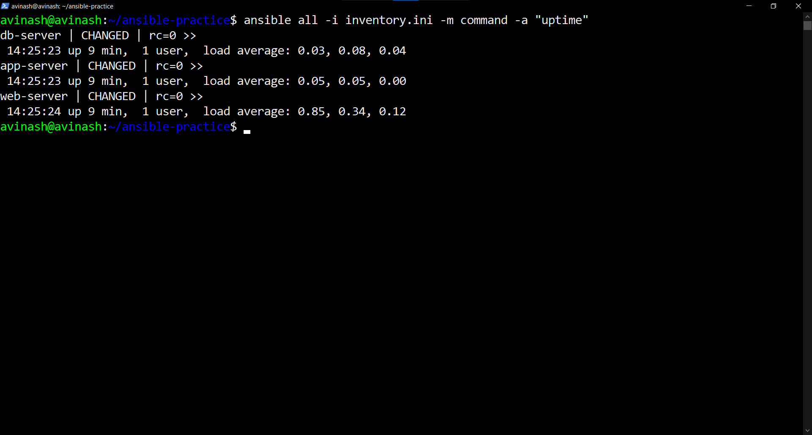

### 2. Check memory usage

```bash
ansible all -m command -a "free -h"
```

The output showed memory and swap information for all three hosts.

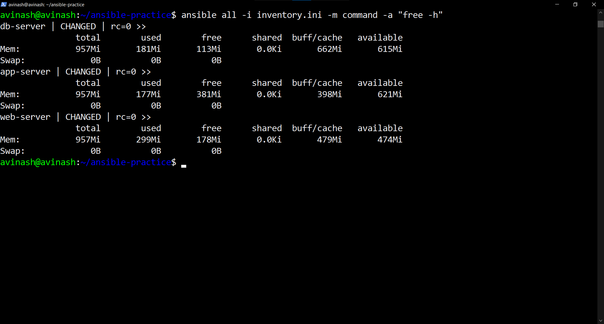

### 3. Check disk usage

```bash
ansible all -m command -a "df -h"
```

The output showed filesystem sizes, used space, available space, and mount points for the managed hosts.

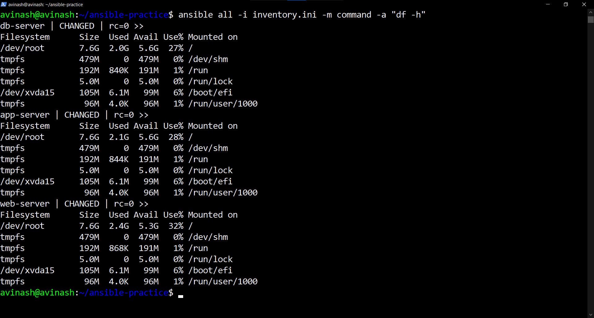

### 4. Check Git on the web group

```bash
ansible web -m command -a "git --version"
```

The web host returned `git version 2.34.1`.

### 5. Copy a file and verify its contents

The lab created a file containing `Hello from Ansible`, copied it to `/tmp/hello.txt` on all three hosts, and then read the file remotely:

```bash
ansible all -m command -a "cat /tmp/hello.txt"
```

All three hosts returned `Hello from Ansible`.

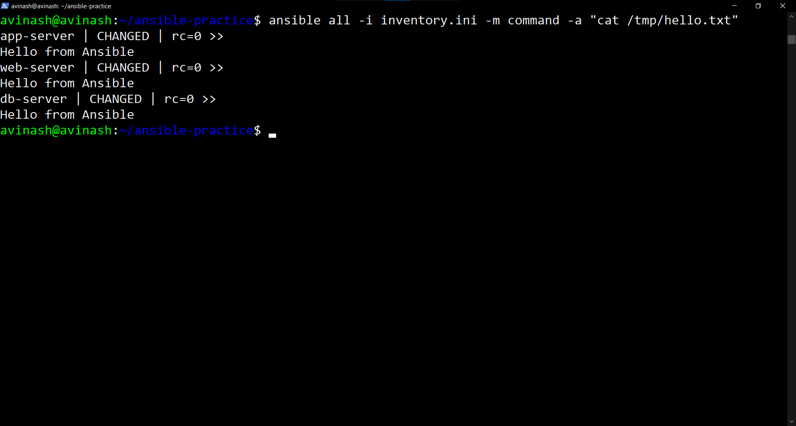

### What does `--become` do?

`--become` enables privilege escalation, commonly through `sudo`, so a task can run with elevated privileges. It is typically needed for package installation and system-level configuration. Use it only when the task requires those privileges.

## Task 6 – Inventory Groups and Patterns

The task specification also asks for child groups (`application` and `all_servers`), host patterns, an `ansible.cfg` file, and a successful `ansible all -m ping` without explicitly specifying `-i inventory.ini`.

**Completion status:** The available screenshots confirm successful connectivity and several ad-hoc commands. They do not, by themselves, prove that all child-group, pattern, and `ansible.cfg` checks were completed. Verify these separately before marking Task 6 complete.

Example child-group configuration:

```ini
[application:children]
web
app

[all_servers:children]
application
db
```

Example `ansible.cfg` for this lab (adjust the username and key path to match your own instances):

```ini
[defaults]
inventory = inventory.ini
host_key_checking = False
remote_user = ec2-user
private_key_file = ~/your-key.pem
```

For Ubuntu-based instances, set `remote_user = ubuntu` instead. Disabling host-key checking is convenient for a disposable lab but reduces SSH host-identity protection; it is not recommended as a general production setting.

## Nginx Verification

The screenshots show the Nginx welcome page in a browser and an Ansible `uri` check returning HTTP status `200`.

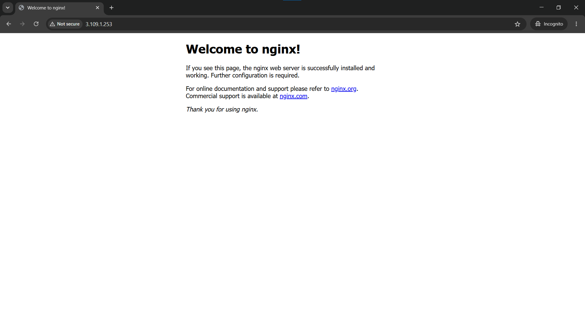

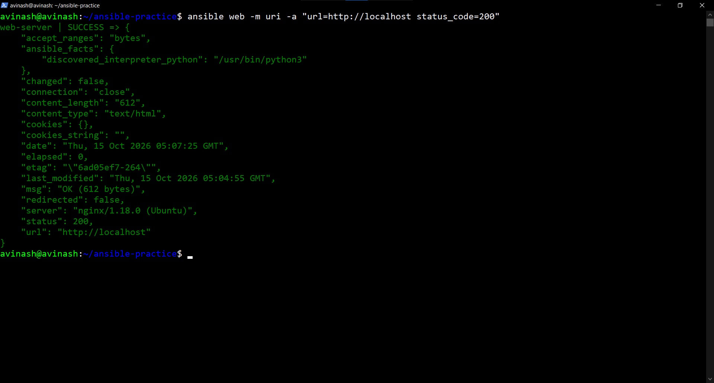

A separate playbook run reports successful tasks for gathering facts, installing Nginx, and starting/enabling the service on the web host:

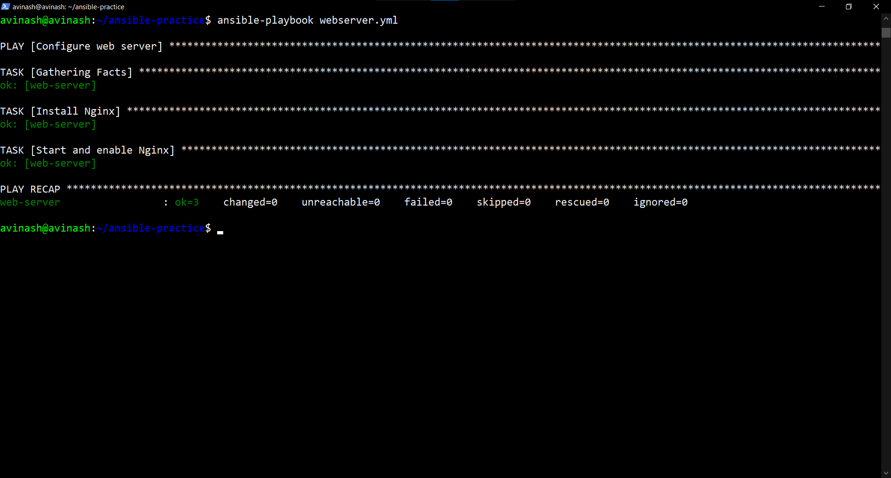

The following additional Nginx-related screenshots are retained for reference:

- `day-68-nginx-web-server.png`
- `day-68-nginx-status.png`

## `command` vs `shell`

- **`command`:** Runs a command directly without shell parsing. Shell pipes, redirection, and expansions are not interpreted.
- **`shell`:** Runs the command through a shell, allowing features such as pipes (`|`), redirection (`>`), and shell variable expansion. Use it only when shell functionality is needed.

## Screenshot Index

The images in this document use relative paths. Keep the Markdown file and the PNG files together in `2026/day-68/` so the images render on GitHub.

| Screenshot | What it demonstrates |
|---|---|
| `01-day-68-ansible-ping.png` | Successful Ansible ping |
| `01-day-68-web-server-running.png` | Web server instance details |
| `02-day-68-three-ec2-instances.png` | Three EC2 instances |
| `02-day-68-uptime.png` | Uptime check |
| `03-day-68-ansible-version.png` | Ansible version |
| `03-day-68-ansible-ping-all-hosts.png` | Ping to all hosts |
| `03-day-68-disk-usage.png` | Disk usage |
| `04-day-68-ansible-ad-hoc-results.png` | Ad-hoc command results and file-copy verification |
| `04-day-68-nginx-status.png` | Nginx status screenshot |
| `05-day-68-memory-usage.png` | Memory usage |
| `day-68-ansible-ad-hoc-commands.png` | Ad-hoc commands |
| `day-68-ansible-playbook-success.png` | Successful Nginx playbook |
| `day-68-nginx-browser-verification.png` | Nginx browser page |
| `day-68-nginx-http-verification.png` | HTTP status check |
| `day-68-nginx-web-server.png` | Nginx web-server screenshot |

## Summary

The evidence captured for this lab demonstrates Ansible installation, three EC2 managed nodes, successful Ansible connectivity, ad-hoc command execution, file-copy verification, and Nginx verification. Before declaring the entire challenge complete, verify the remaining Task 6 group/pattern/configuration checks and confirm that all screenshot filenames listed above exist in the folder.


