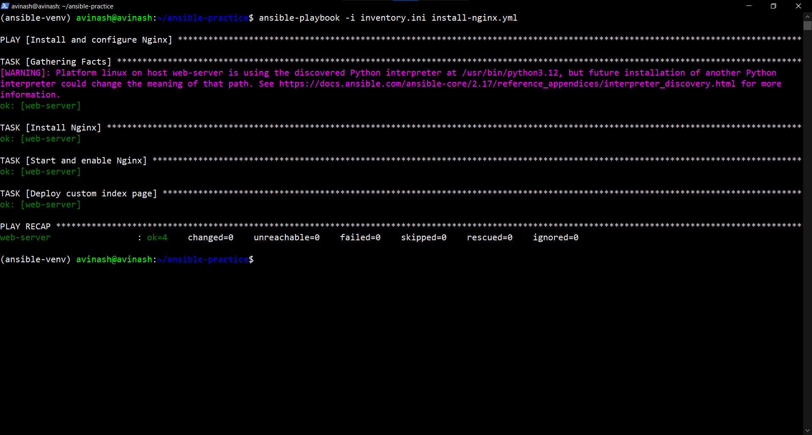
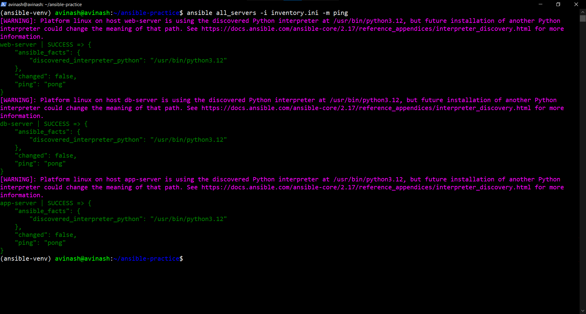
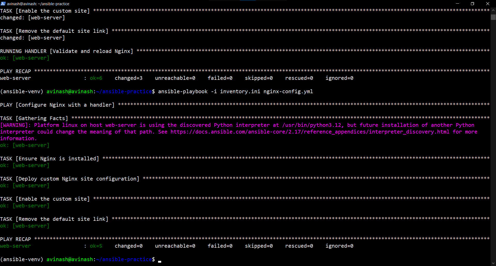

# Day 69 — Ansible Playbooks and Modules

## Objective

Practise Ansible playbooks, essential modules, handlers, idempotency, execution options, and multi-play automation using three Ubuntu EC2 instances.

## Environment

- Control node: Ubuntu on WSL
- Automation tool: Ansible Core 2.17.14
- Managed nodes: `web-server`, `app-server`, `db-server`
- Cloud region: AWS Mumbai (`ap-south-1`)
- Operating system: Ubuntu Server

## Task 1 — Install and Configure Nginx

**Playbook:** `install-nginx.yml`

Implemented:
- Installed Nginx using the `apt` module.
- Started and enabled the Nginx service.
- Deployed a custom HTML page using the `copy` module.
- Used `become: true` for privilege escalation.

**Idempotency result:** The playbook ran twice successfully. The second run reported `changed=0` and `failed=0`.



## Task 2 — Playbook Concepts

- **Playbook:** A YAML file defining automation.
- **Play:** Maps hosts to tasks.
- **Task:** An individual automation operation.
- **Module:** Performs an operation, such as package installation or file management.
- **`become: true`:** Enables privilege escalation, typically through sudo.
- **Idempotency:** Repeated execution converges on the desired state without unnecessary changes.
- **Failure handling:** An unhandled task failure normally stops further tasks for that host. Other hosts can continue. Use `ignore_errors`, `failed_when`, or block/rescue where appropriate.

## Task 3 — Essential Modules

**Playbook:** `essential-modules.yml`

Modules practised:
- `apt` — package installation.
- `service` — service state and enablement.
- `copy` — copy configuration content to managed hosts.
- `file` — create directories and manage permissions.
- `command` — execute a command without shell processing.
- `register` — store task output in a variable.
- `debug` — display registered output.
- `shell` — execute a command through a shell.
- `lineinfile` — ensure a configuration line exists.

**Configuration file:** `files/app.conf`

The playbook ran against all three servers. The final recap reported `failed=0` and `unreachable=0` for each host.



## Task 4 — Nginx Configuration and Handlers

**Playbook:** `nginx-config.yml`

Implemented:
- Deployed a dedicated Nginx site configuration.
- Enabled the site and removed the default site link.
- Used `notify` to trigger a handler when configuration changed.
- Validated the configuration with `nginx -t` before reloading Nginx.

**Result:** The first run changed the configuration and triggered the handler. The second run reported `changed=0`, so the handler was not triggered again.



## Task 5 — Ansible Command-Line Options

| Option | Purpose |
|---|---|
| `--check` | Preview changes without applying them where supported. |
| `--diff` | Display differences for supported file changes. |
| `-v` | Show additional execution details. |
| `--limit web-server` | Restrict execution to a selected host. |
| `--list-hosts` | List hosts matched by the playbook. |
| `--list-tasks` | List tasks without executing them. |
| `--syntax-check` | Validate playbook syntax. |

Examples:

```bash
ansible-playbook -i inventory.ini install-nginx.yml --check
ansible-playbook -i inventory.ini install-nginx.yml --check --diff
ansible-playbook -i inventory.ini install-nginx.yml -v
ansible-playbook -i inventory.ini install-nginx.yml --limit web-server
ansible-playbook -i inventory.ini install-nginx.yml --list-hosts
ansible-playbook -i inventory.ini install-nginx.yml --list-tasks
```

## Task 6 — Multi-Play Automation

**Playbook:** `multi-play.yml`

Three separate plays targeted the inventory groups:

- **Web:** Installed and started Nginx.
- **App:** Installed curl and created `/opt/day69-app`.
- **DB:** Installed the MySQL client and created `/opt/day69-db`.

The playbook completed successfully with no failed or unreachable hosts.

## Files

- `install-nginx.yml`
- `essential-modules.yml`
- `nginx-config.yml`
- `multi-play.yml`
- `files/app.conf`
- `day-69-playbooks.md`

## Key Takeaways

- Ansible playbooks automate repeatable infrastructure configuration.
- Modules provide declarative resource management.
- Idempotency helps prevent unnecessary changes.
- Handlers run in response to notified changes.
- Inventory groups allow targeted multi-host automation.
- Check mode, diff mode, verbosity, and execution limits improve testing and troubleshooting.

