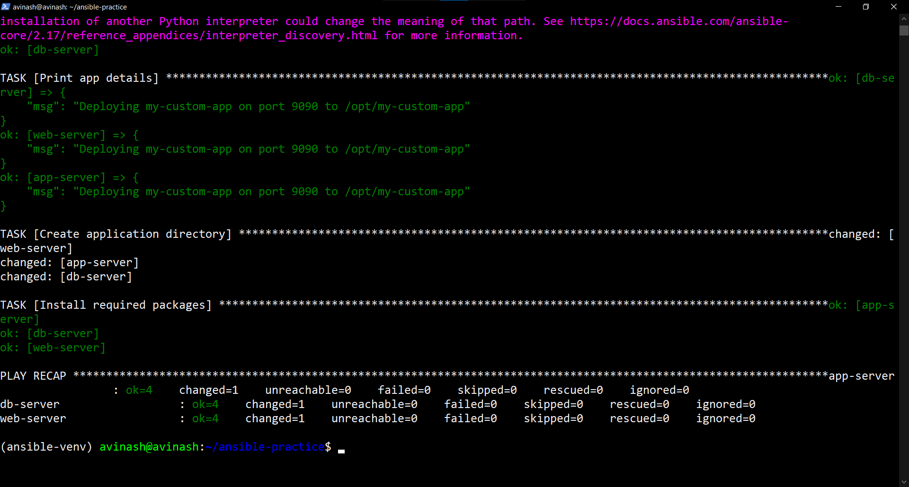
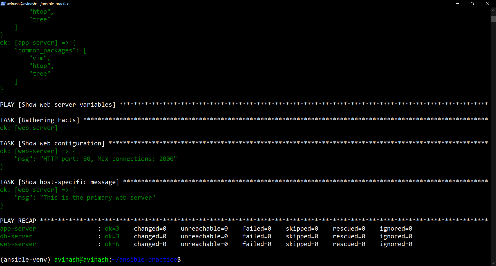
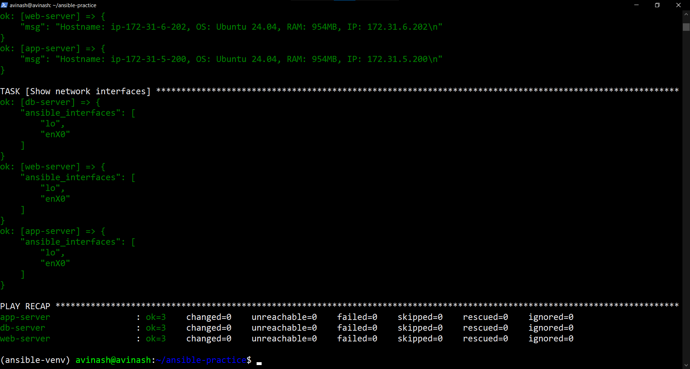
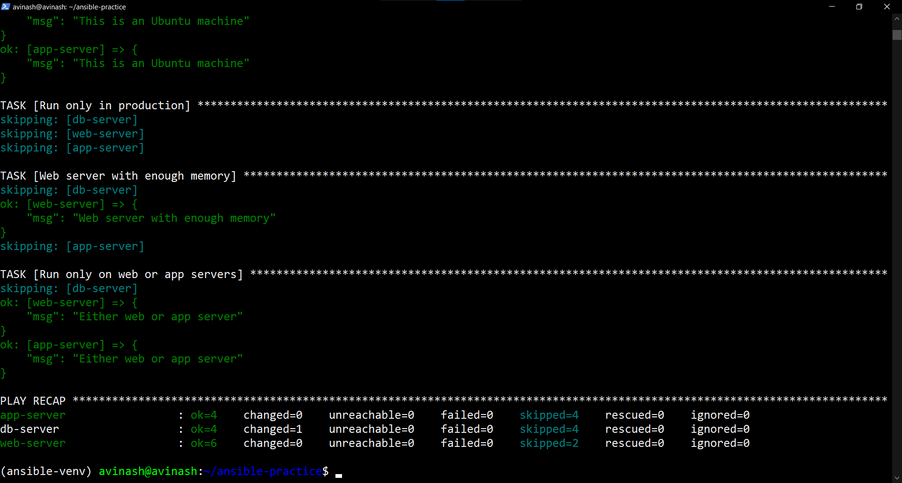
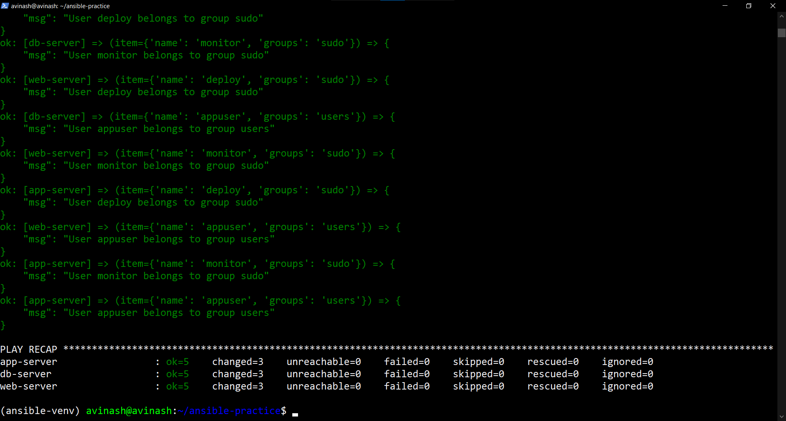
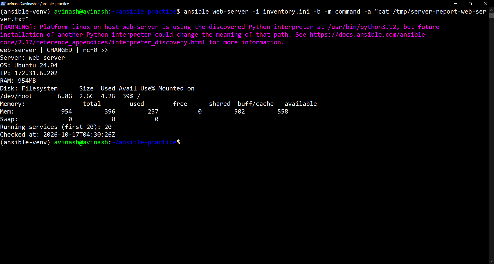

# Day 70 — Variables, Facts, Conditionals and Loops

## Objective

Practise Ansible variables, variable precedence, facts gathering, conditional execution, loops, and automated server health reporting using three Ubuntu EC2 instances.

## Environment

- Control node: Ubuntu on WSL
- Ansible Core: 2.17.14
- Managed nodes: `web-server`, `app-server`, `db-server`
- Operating system: Ubuntu 24.04
- Inventory: `inventory.ini`

## Task 1 — Variables in Playbooks

**File:** `variables-demo.yml`

Defined variables for the application name, port, application directory, and required packages. The playbook created the application directory and ensured `git`, `curl`, and `wget` were installed.

### Command-line override

```bash
ansible-playbook -i inventory.ini variables-demo.yml -e "app_name=my-custom-app app_port=9090"
```

Verified output:

```text
Deploying my-custom-app on port 9090 to /opt/my-custom-app
```

The `-e` option overrides the corresponding playbook variables.



## Task 2 — Group Variables and Host Variables

### Directory structure

```text
day-70/
├── group_vars/
│   ├── all.yml
│   ├── web.yml
│   └── db.yml
├── host_vars/
│   └── web-server.yml
└── playbooks/
    └── site.yml
```

### Shared variables — `group_vars/all.yml`

```yaml
---
ntp_server: pool.ntp.org
app_env: development
common_packages:
  - vim
  - htop
  - tree
```

These variables are available to all inventory hosts.

### Web group variables — `group_vars/web.yml`

```yaml
---
http_port: 80
max_connections: 1000
web_packages:
  - nginx
```

### Database group variables — `group_vars/db.yml`

```yaml
---
db_port: 3306
db_packages:
  - mysql-server
```

### Host variables — `host_vars/web-server.yml`

```yaml
---
max_connections: 2000
custom_message: "This is the primary web server"
```

### Variable precedence demonstrated

The `playbooks/site.yml` playbook showed the resolved values.

| Variable source | Variable | Value |
|---|---|---|
| `group_vars/web.yml` | `max_connections` | `1000` |
| `host_vars/web-server.yml` | `max_connections` | `2000` |
| Command line with `-e` | `app_port` override | `9090` |

**Result:** `web-server` displayed `Max connections: 2000`, because its host-specific value overrides the web group's value of `1000`. Extra variables passed with `-e` have higher precedence than these inventory and playbook variables.



## Task 3 — Ansible Facts

**File:** `facts-demo.yml`

Ansible facts were used to display each server's operating system, memory, IP address, and network interfaces.

### Five useful facts

| Fact | Practical use |
|---|---|
| `ansible_hostname` | Identify a managed host in a report |
| `ansible_distribution` | Apply OS-specific configuration |
| `ansible_distribution_version` | Handle version-specific requirements |
| `ansible_memtotal_mb` | Check memory capacity before deploying applications |
| `ansible_default_ipv4.address` | Identify the host's private IPv4 address |

Verified details included Ubuntu 24.04, Debian OS family, and 954 MB RAM on the web server. Its private IPv4 address was `172.31.6.202`.



## Task 4 — Conditionals with `when`

**File:** `conditional-demo.yml`

The playbook used conditions to control task execution:

```yaml
when: "'web' in group_names"
```

Targets hosts in the `web` group.

```yaml
when: ansible_memtotal_mb < 1024
```

Displays a warning when a host has less than 1024 MB RAM.

```yaml
when: app_env == "production"
```

Runs a task only when the environment is production.

### Observed results

- The Nginx task targeted the web server.
- The MySQL Server installation task targeted the database server.
- The low-memory warning ran on hosts with 954 MB RAM.
- The production-only task was skipped because `app_env` was `development`.
- The web-with-enough-memory condition ran on `web-server`.
- The web-or-app condition ran on the web and application servers.



## Task 5 — Loops

**File:** `loops-demo.yml`

The `loop` keyword managed multiple users, directories, and packages without duplicating tasks.

### Users

- `deploy` — assigned to the `sudo` group
- `monitor` — assigned to the `sudo` group
- `appuser` — assigned to the `users` group

### Directories

```text
/opt/app/logs
/opt/app/config
/opt/app/data
/opt/app/tmp
```

### Packages

```text
git
curl
unzip
jq
```

### Example loop

```yaml
- name: Create multiple directories
  ansible.builtin.file:
    path: "{{ item }}"
    state: directory
    mode: '0755'
  loop: "{{ directories }}"
```

Ansible iterates over each item in the list. The playbook completed on all three servers without failed or unreachable hosts.



## Task 6 — Server Health Report

**File:** `server-report.yml`

The playbook combined Ansible facts, command output, a conditional disk-usage check, and report-file creation. It collected OS details, private IP, RAM, root filesystem usage, memory output, running-service count, and a timestamp.

Reports were saved on the managed servers:

```text
/tmp/server-report-web-server.txt
/tmp/server-report-app-server.txt
/tmp/server-report-db-server.txt
```

### Verified report output — `web-server`

```text
Server: web-server
OS: Ubuntu 24.04
IP: 172.31.6.202
RAM: 954MB
Disk: Filesystem      Size  Used Avail Use% Mounted on
/dev/root       6.8G  2.6G  4.2G  39% /
Memory:                total        used        free      shared  buff/cache   available
Mem:             954         396         237           0         502         558
Swap:              0           0           0
Running services (first 20): 20
Checked at: 2026-10-17T04:30:26Z
```

The report verification succeeded. Root filesystem usage was 39%, so the high-disk-usage alert was skipped.



## Key Learnings

- Variables make playbooks reusable and configurable.
- Host-specific values can override group values.
- Extra variables supplied with `-e` take high precedence.
- Ansible facts provide information for automation decisions and reporting.
- `when` controls which tasks run on each host.
- Loops manage lists of users, directories, and packages.
- `register` stores command results for later tasks.
- Health reports combine facts and live command output.

## Validation

All six practical playbooks passed syntax checks. The captured executions completed without failed or unreachable hosts.
