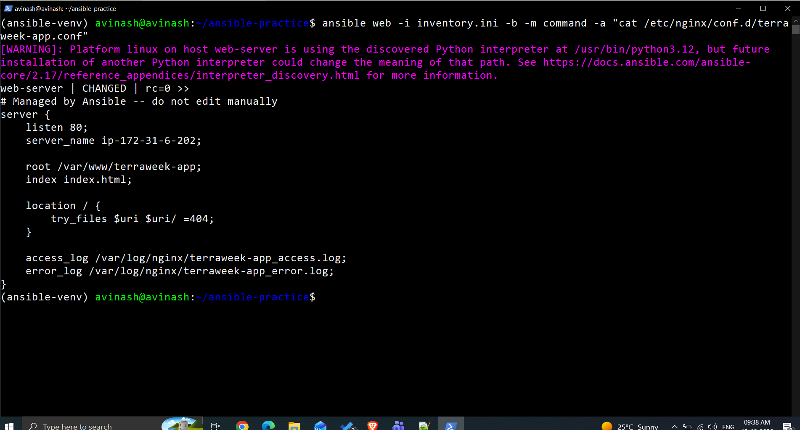
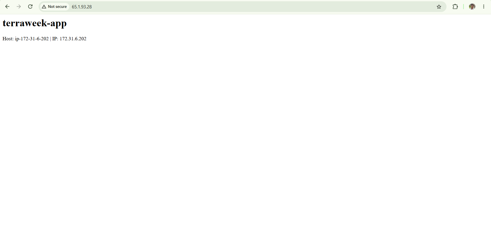
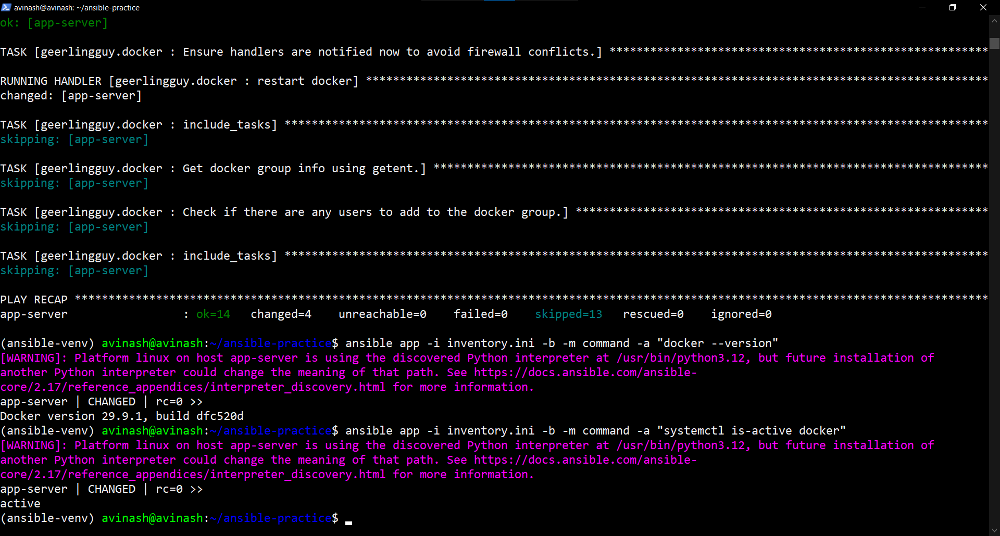
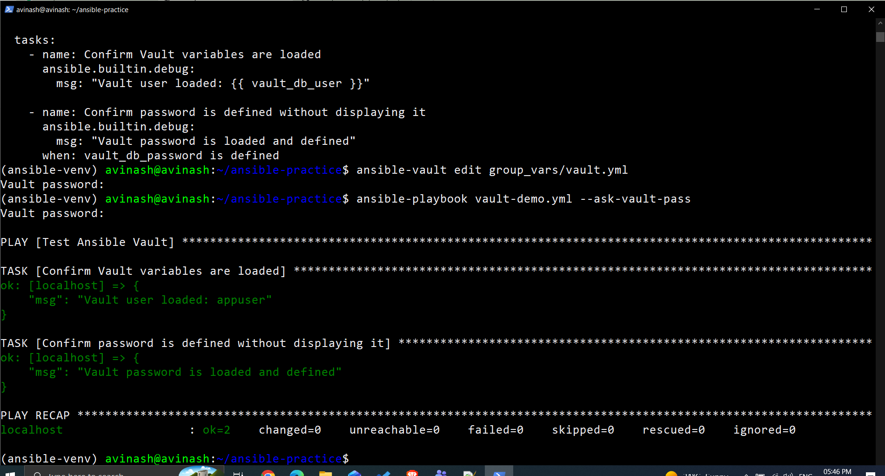
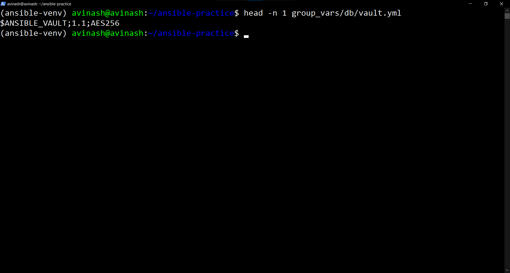
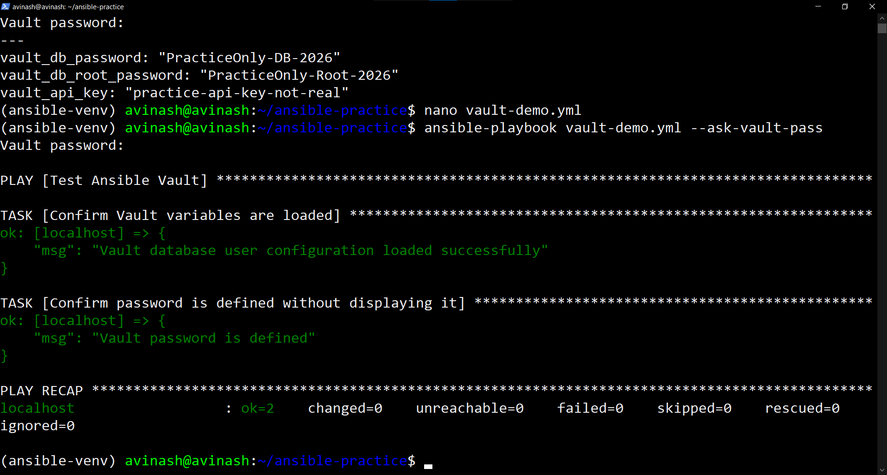

# Day 71: Ansible Roles, Templates, and Vault

## Overview

This exercise covers Jinja2 templates, Ansible roles, Ansible Galaxy, and Ansible Vault. The final playbook combines these concepts to configure web servers, application servers, and database servers.

## Task 1: Jinja2 Templates

Created a Jinja2 template for an Nginx virtual host configuration.

- Used variables for the HTTP port, application name, and hostname.
- Used the `default` filter for optional values.
- Executed the template playbook and checked the rendered configuration.

## Task 2: Ansible Role Structure

Initialized the `webserver` role using `ansible-galaxy init`.

Important directories:

- `tasks/`: Tasks executed by the role.
- `handlers/`: Handlers triggered by task notifications.
- `templates/`: Jinja2 templates.
- `defaults/`: Default variables with lower precedence.
- `vars/`: Role variables with higher precedence.
- `files/`: Static files.
- `meta/`: Role metadata and dependencies.

## Task 3: Custom Webserver Role

Created a custom role to install and configure Nginx and deploy an application page.

The role uses templates for the Nginx configuration and application index page. Variables such as `app_name`, `http_port`, and `max_connections` make the role reusable.

The playbook was executed successfully, and the webserver configuration was deployed.

## Task 4: Ansible Galaxy

Installed and used the `geerlingguy.docker` Galaxy role to configure Docker on the application server.

Verification included checking the Docker version and confirming that the Docker service was active.

### Why use requirements.yml?

A `requirements.yml` file records the roles and versions a project depends on. It makes role installation repeatable and helps keep development, testing, and deployment environments consistent.

## Task 5: Ansible Vault

Used Ansible Vault to encrypt sensitive database variables.

The encrypted file is:

`group_vars/db/vault.yml`

Vault operations practiced:

- `ansible-vault create`
- `ansible-vault edit`
- `ansible-vault view`
- `ansible-vault encrypt`
- Running playbooks with `--ask-vault-pass`

Vault protects secrets at rest. The Vault password must be stored separately and must never be committed to Git.

### Vault password handling

`--ask-vault-pass` prompts for the password interactively. A protected password file can be useful for automated CI/CD jobs, but it must have restrictive permissions, be excluded from version control, and be managed securely. Production pipelines should prefer an appropriate secret-management mechanism.

## Task 6: Combine Roles, Templates, and Vault

The root `site.yml` playbook combines three server configurations:

1. **Web servers:** Uses the custom `webserver` role.
2. **Application servers:** Uses the `geerlingguy.docker` role.
3. **Database servers:** Deploys the database configuration using a Jinja2 template and encrypted Vault variables.

The template is `templates/db-config.j2`. It uses the database host address, a configurable database port, and encrypted database credentials.

The rendered file is deployed to:

`/etc/db-config.env`

Its owner, group, and permissions are:

- Owner: `root`
- Group: `root`
- Mode: `0600`

### Verification

The combined playbook completed successfully on all three hosts:

- `web-server`
- `app-server`
- `db-server`

The database configuration file permissions were verified:

`600 root:root /etc/db-config.env`

The configuration contents were not printed during the security verification.

## Key Takeaways

- Jinja2 templates make configurations dynamic and reusable.
- Roles organize Ansible automation into maintainable components.
- Ansible Galaxy provides reusable community roles.
- Ansible Vault encrypts sensitive variables.
- File permissions and secure password handling are important when deploying secrets.
- A single playbook can orchestrate configuration across multiple inventory groups.
