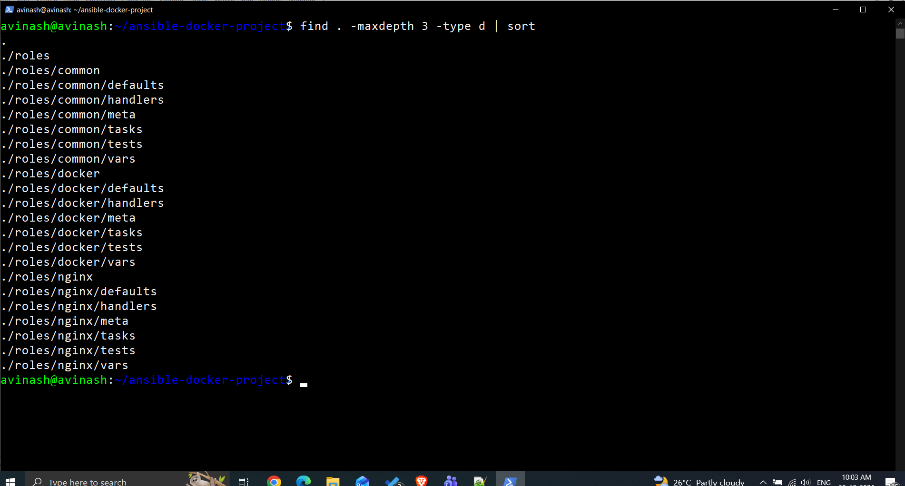
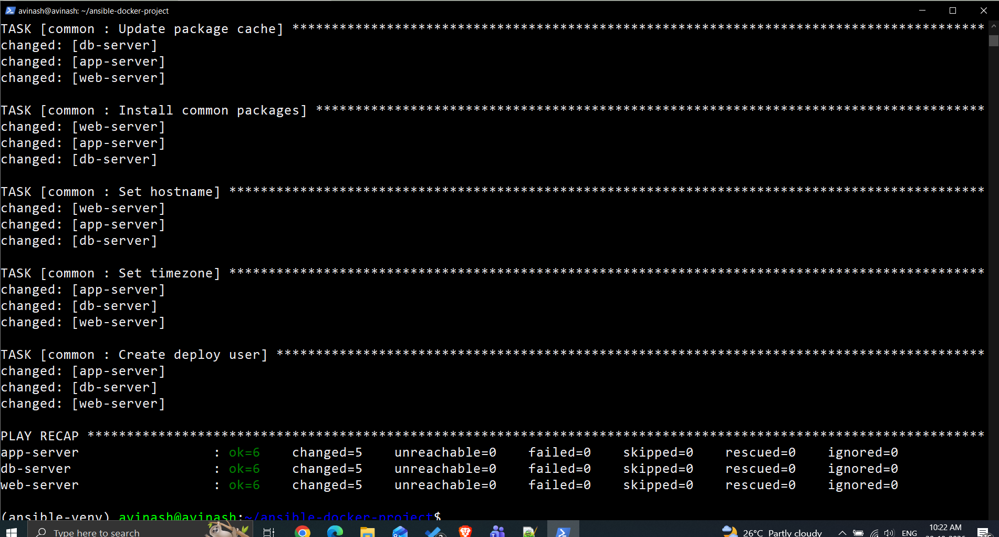
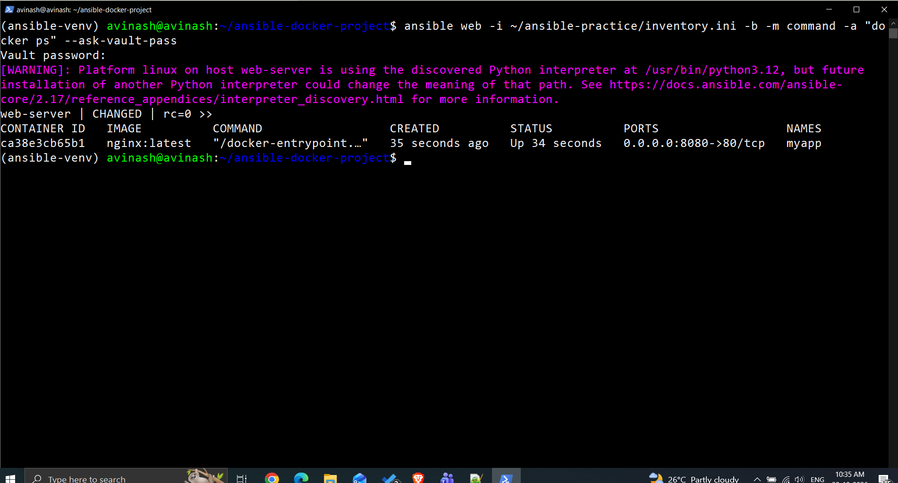
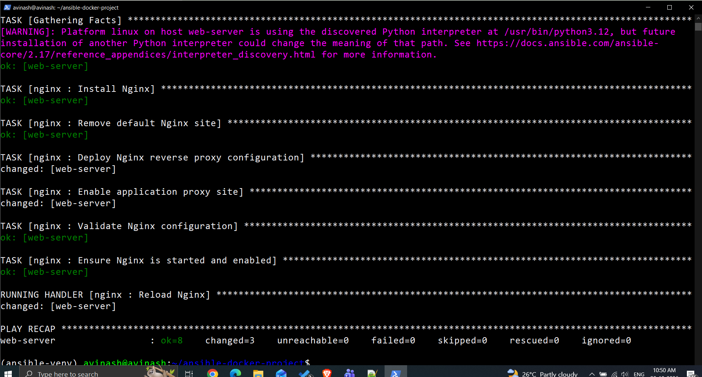
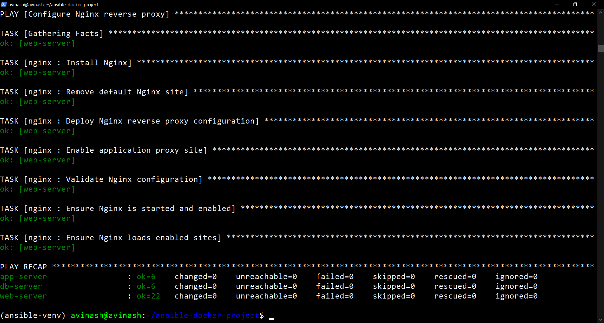

# Day 72 — Ansible Project

## Objective

Build a role-based Ansible project that configures common server settings, deploys a Docker container, and configures Nginx as a reverse proxy.

## Project structure

The project uses separate Ansible roles for common configuration, Docker, and Nginx. The main playbook is `site.yml`.

```text
ansible-docker-project/
├── ansible.cfg
├── group_vars/
│   ├── all.yml
│   └── web/
│       ├── vars.yml
│       └── vault.yml
├── roles/
│   ├── common/
│   ├── docker/
│   └── nginx/
└── site.yml
```

## Implementation

### 1. Project structure

Created the Ansible project and initialized the `common`, `docker`, and `nginx` roles.



### 2. Common role

Configured all servers to:
- Update the APT package cache.
- Install common utilities (`vim`, `curl`, `wget`, `git`, `htop`, `tree`, `jq`, and `unzip`).
- Set the hostname from the inventory hostname.
- Set the timezone to `Asia/Kolkata`.
- Create the `deploy` user and add it to the `sudo` group.

Applied the role to the `all_servers` inventory group.



### 3. Docker role

Configured the web server to install and enable Docker, pull the `nginx:latest` image, run the `myapp` container, and check the application health endpoint. Docker Hub credentials are stored in the encrypted Ansible Vault file `group_vars/web/vault.yml`; `.vault_pass` is excluded through `.gitignore`.

The container was verified as running with host port `8080` mapped to container port `80`.



### 4. Nginx reverse proxy

Configured Nginx to listen on port `80`, proxy application requests to `127.0.0.1:8080`, and expose a `/health` endpoint. The Nginx configuration test passed, and the health endpoint returned HTTP `200` with the body `healthy` when requested with the `Host: day72.local` header.

The host already had other Nginx sites configured. `nginx -T` reported conflicting `server_name "_"` warnings from those existing sites, although the configuration syntax test passed. These existing sites were not removed.



### 5. Main playbook and validation

Created `site.yml` to apply:
1. The `common` role to `all_servers`.
2. The `docker` role to `web`.
3. The `nginx` role to `web`.

The playbook passed syntax validation and completed in check mode and normal deployment without failed or unreachable hosts.

### 6. Idempotency

Ran `ansible-playbook site.yml` a second time. The recap showed `changed=0` and `failed=0` on all three hosts, confirming that the configuration was idempotent for the tested state.



## Commands used for verification

```bash
ansible-playbook site.yml --syntax-check
ansible-playbook site.yml --check --diff
ansible-playbook site.yml
ansible web -b -m command -a "docker ps"
ansible web -b -m uri -a 'url=http://127.0.0.1/health status_code=200 return_content=true headers={"Host":"day72.local"}'
```

## Security notes

- Docker Hub credentials are stored in Ansible Vault.
- `.vault_pass` is protected with file permissions and listed in `.gitignore`.
- Do not commit `.vault_pass` or expose decrypted credentials.

