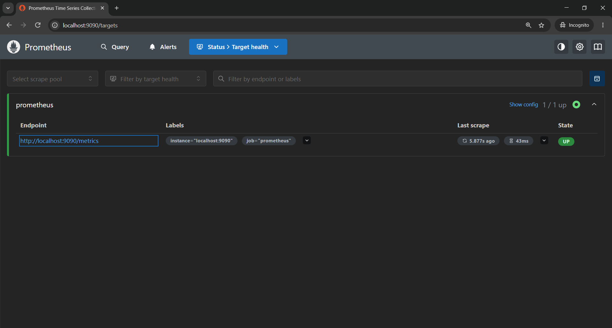
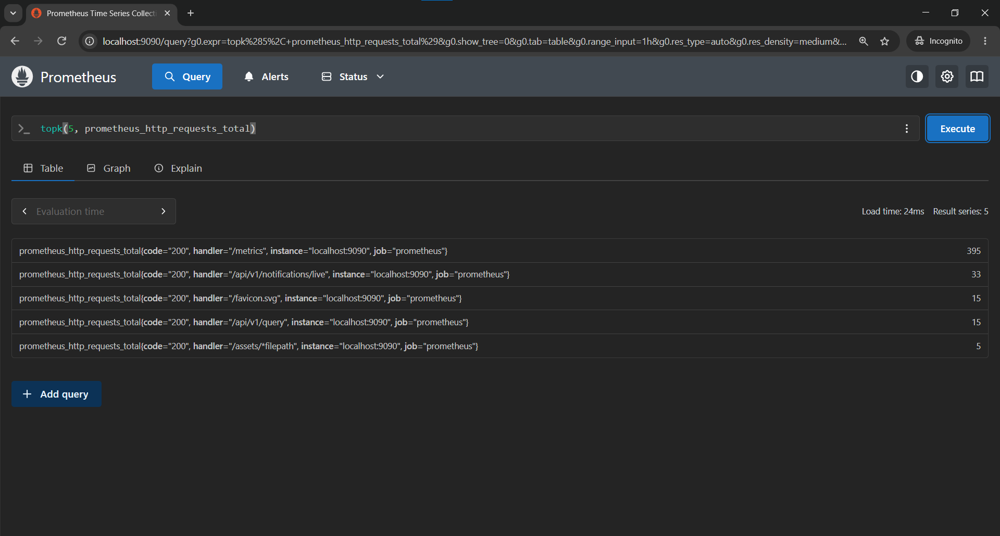
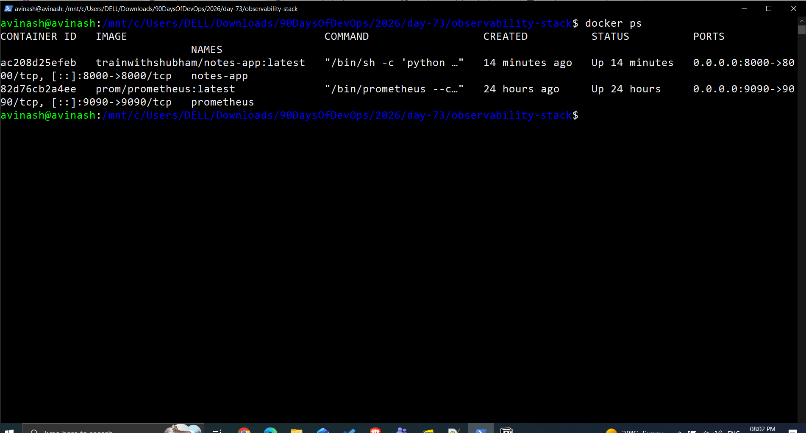
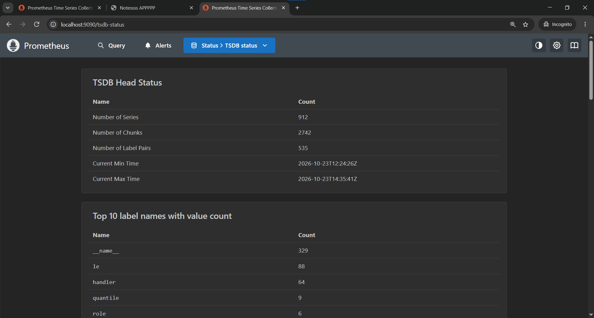

# Day 73 — Introduction to Observability and Prometheus

## 1. What Is Observability?

Observability is the ability to understand a system's internal state by examining the data it produces.

### Three Pillars of Observability

- **Metrics:** Numeric measurements over time, such as CPU usage, memory usage, and HTTP request rates.
- **Logs:** Timestamped records of events, errors, and application activity.
- **Traces:** Show how a request travels across services and help identify latency or failures.

### Monitoring vs. Observability

- **Monitoring** checks known conditions and alerts us when predefined thresholds are exceeded.
- **Observability** helps investigate why a system behaves in a particular way using metrics, logs, and traces.

## 2. Prometheus Architecture

```text
[Application] ---> Metrics ---> [Prometheus] ---> [Grafana]
[Host] ---------> Metrics ---> [Node Exporter] ---> [Prometheus]
[Docker] -------> Metrics ---> [cAdvisor] --------> [Prometheus]
[Application] ---> Logs -----> [Promtail] --------> [Loki] ---> [Grafana]
[Application] ---> Traces ---> [OpenTelemetry Collector] ---> [Tracing Backend]
```

## 3. Prometheus Setup

Created an observability stack using Docker Compose.

### `prometheus.yml`

```yaml
global:
  scrape_interval: 15s
  evaluation_interval: 15s

scrape_configs:
  - job_name: "prometheus"
    static_configs:
      - targets: ["localhost:9090"]
```

### `docker-compose.yml`

```yaml
services:
  prometheus:
    image: prom/prometheus:latest
    container_name: prometheus
    ports:
      - "9090:9090"
    volumes:
      - ./prometheus.yml:/etc/prometheus/prometheus.yml
      - prometheus_data:/prometheus
    command:
      - '--config.file=/etc/prometheus/prometheus.yml'
    restart: unless-stopped

  notes-app:
    image: trainwithshubham/notes-app:latest
    container_name: notes-app
    ports:
      - "8000:8000"
    restart: unless-stopped

volumes:
  prometheus_data:
```

### Validation

- Prometheus UI: http://localhost:9090
- Notes application: http://localhost:8000
- Prometheus target `localhost:9090/metrics` was `UP`.
- Both Docker containers were running successfully.
- The Notes application returned HTTP 200 for five test requests.
- The Notes application's `/metrics` endpoint returned HTTP 404, so it is not currently scraped by Prometheus.

## 4. PromQL Practice

| Query | Purpose |
|---|---|
| `up` | Check whether a scrape target is healthy |
| `count({__name__=~".+"})` | Count matching metric time series |
| `process_resident_memory_bytes` | Inspect Prometheus process memory in bytes |
| `prometheus_http_requests_total` | Inspect cumulative HTTP request counters |
| `prometheus_http_requests_total{handler="/api/v1/query"}` | Filter requests by handler |
| `rate(prometheus_http_requests_total[5m])` | Estimate per-second request rates over five minutes |
| `sum(rate(prometheus_http_requests_total[5m]))` | Calculate the total request rate |
| `prometheus_http_requests_total{code="200"}` | Filter HTTP 200 responses |
| `prometheus_http_requests_total{code!="200"}` | Filter responses with other status codes |
| `process_resident_memory_bytes / 1024 / 1024` | Convert memory usage to MiB |
| `topk(5, prometheus_http_requests_total)` | Display the five highest request-counter series |

### Observed Results

- `up`: 1
- Matching time series count: 912
- Prometheus resident memory: approximately 86.54 MiB
- Total HTTP request rate: approximately 0.151 requests per second at the time of measurement
- The `topk` query returned five series; `/metrics` had a counter value of 359 in the captured result.
- A non-200 response series showed HTTP 302, which indicates a redirect rather than necessarily an error.

## 5. Counter vs. Gauge

- **Counter:** A cumulative value that increases over time and resets when the process restarts. Example: `prometheus_http_requests_total`.
- **Gauge:** A value that can increase or decrease. Example: `process_resident_memory_bytes`.

## 6. Data Storage and Retention

- Prometheus data directory: `/prometheus`
- Docker volume: `prometheus_data`
- Observed storage usage: approximately 4.2 MB
- Prometheus default retention is 15 days unless configured otherwise.
- Persistent storage helps retain monitoring data across container recreation.

The current container command only specifies the configuration file; no custom retention argument is configured.

## 7. Screenshots

Screenshots are saved in the `2026/day-73/` directory. The paths below are relative to this Markdown file.

### 1. Prometheus Target Health


File: `./day-73-prometheus-targets-up.png`

### 2. PromQL Top 5 HTTP Requests


File: `./day-73-promql-top-5-http-requests.png`

### 3. Notes Application Running


File: `./day-73-notes-app-running.png`

### 4. Prometheus TSDB Status


File: `./day-73-prometheus-tsdb-status.png`

## 8. Key Takeaways

- Learned the three pillars of observability: metrics, logs, and traces.
- Deployed Prometheus using Docker Compose.
- Verified the Prometheus target was UP.
- Practised PromQL queries, label filtering, rate calculations, and top-k selection.
- Inspected Prometheus TSDB statistics and storage usage.
- Deployed a sample Notes application and verified its HTTP responses.
- Identified that the Notes application does not expose `/metrics` and requires instrumentation or an exporter before Prometheus can scrape its application metrics.
