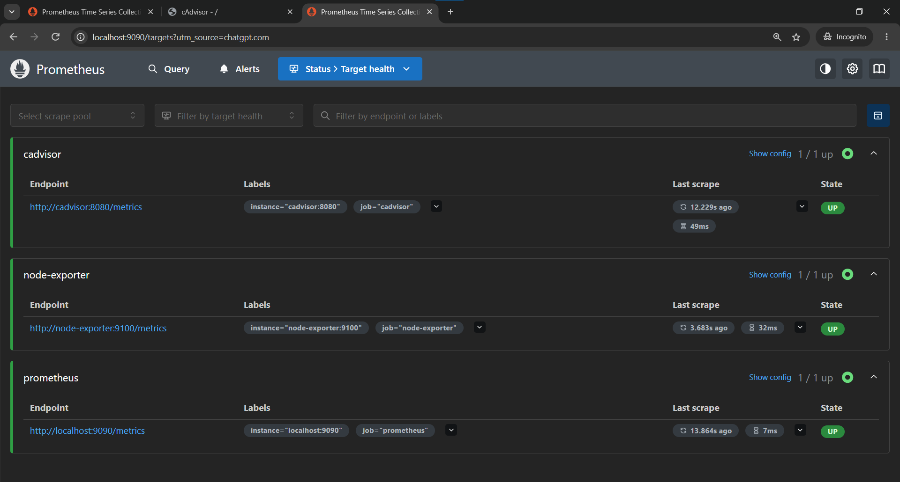
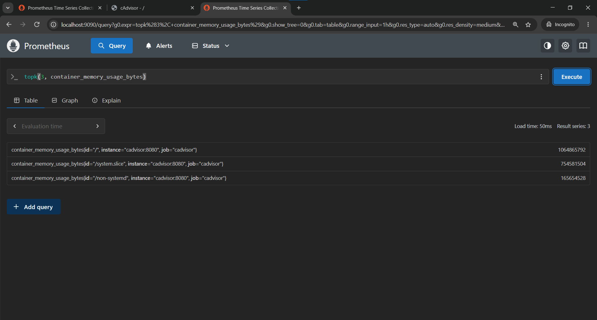
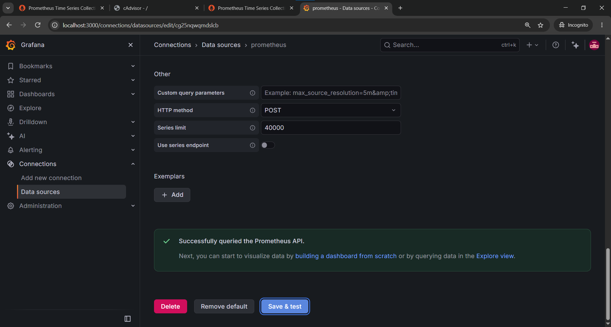
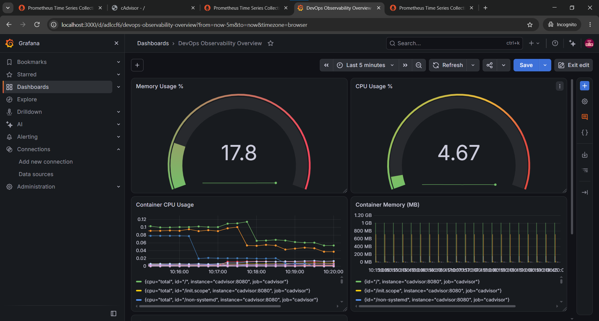
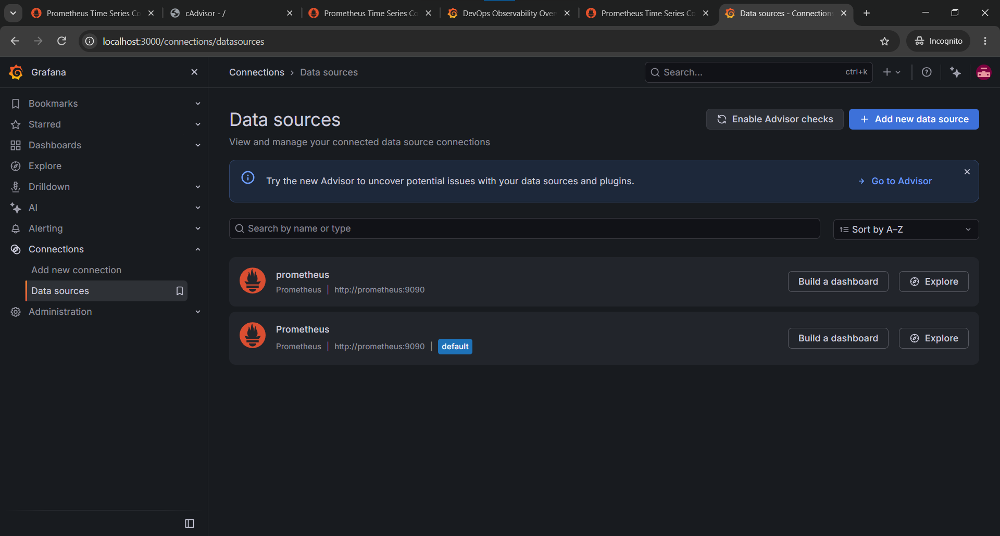
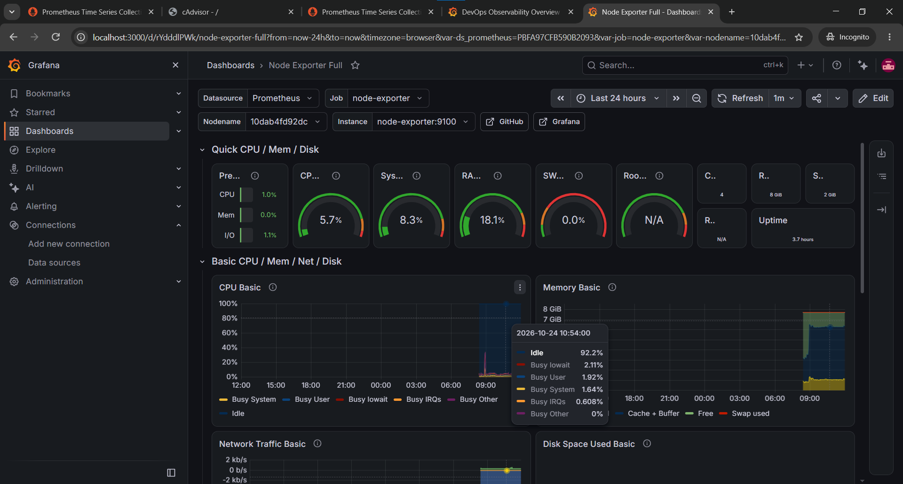

# Day 74 — Exporters and Grafana

## Objective

Extend the Day 73 Prometheus observability stack by adding Node Exporter and cAdvisor, connect Grafana to Prometheus, create dashboard panels, and configure datasource provisioning using YAML.

## Architecture

The Docker Compose stack contains:

- **Prometheus** — scrapes metrics from Prometheus itself, Node Exporter, and cAdvisor.
- **Node Exporter** — exposes host-level metrics such as CPU and memory.
- **cAdvisor** — exposes container metrics.
- **Grafana** — visualizes metrics from Prometheus.
- **Notes app** — sample application included in the stack.

Configuration files are included in [`observability-stack/`](observability-stack/).

## 1. Verify Prometheus targets

Prometheus was configured to scrape the Prometheus server, Node Exporter, and cAdvisor. All three targets were shown as **UP**.

## 2. Node Exporter and cAdvisor metrics

Node Exporter exposes host metrics, and cAdvisor exposes container metrics. The cAdvisor metrics endpoint was checked and container CPU and memory metrics were available.

## 3. Configure Grafana's Prometheus datasource

Grafana was connected to Prometheus using the URL `http://prometheus:9090`. The datasource test succeeded.

## 4. Build a custom Grafana dashboard

Created the **DevOps Observability Overview** dashboard with these panels:

- CPU Usage %
- Memory Usage %
- Container CPU Usage
- Container Memory (MB)

## 5. Provision the datasource with YAML

Created `observability-stack/grafana/provisioning/datasources/prometheus.yml` and mounted the datasource provisioning directory into the Grafana container through `docker-compose.yml`.

The provisioned datasource was visible in Grafana and the Prometheus API test succeeded.

## 6. Import a community dashboard

Imported **Node Exporter Full** from Grafana.com using dashboard ID **1860**.

## Environment note: filesystem metrics in WSL2

The Node Exporter filesystem collector reports a parsing error for a `9p` filesystem in this WSL2 environment. As a result, filesystem metrics such as `node_filesystem_size_bytes` are unavailable, and the dashboard's **Disk Space Used Basic** panel shows `No data`. CPU, memory, and network metrics are available. This limitation is documented rather than presenting disk metrics as working.

## Files

- `day-74-exporters-grafana.md` — this documentation.
- `day-74-prometheus-targets-all-up.png` — Prometheus target health.
- `day-74-cadvisor-container-metrics.png` — cAdvisor metrics evidence.
- `day-74-grafana-prometheus-datasource.png` — datasource configuration.
- `day-74-grafana-dashboard.png` — custom four-panel dashboard.
- `day-74-grafana-provisioning.png` — successful datasource provisioning.
- `day-74-node-exporter-full.png` — imported community dashboard.
- `observability-stack/` — Docker Compose, Prometheus, and Grafana provisioning configuration.

All image references above are relative to this Markdown file. Keep the PNG files in the same `2026/day-74/` directory when committing so GitHub renders them inline.
