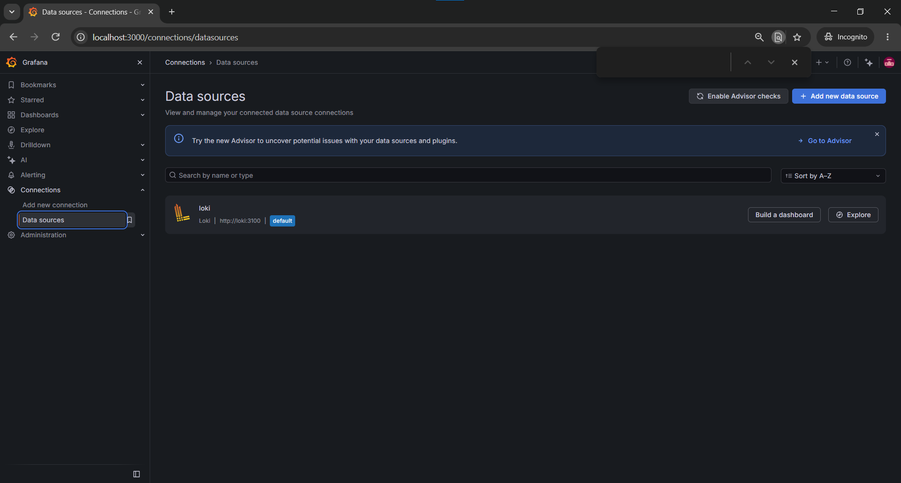
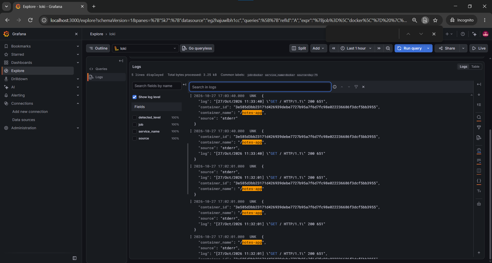
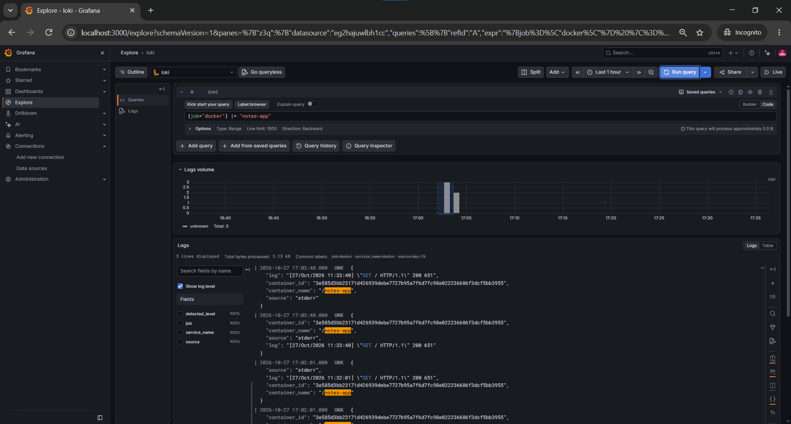
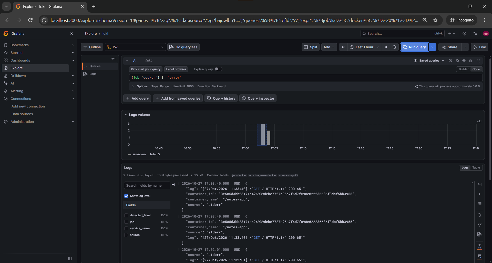
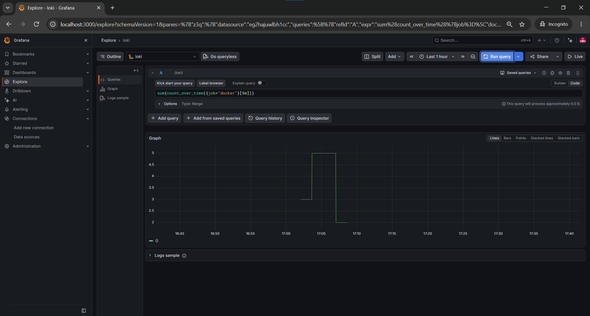
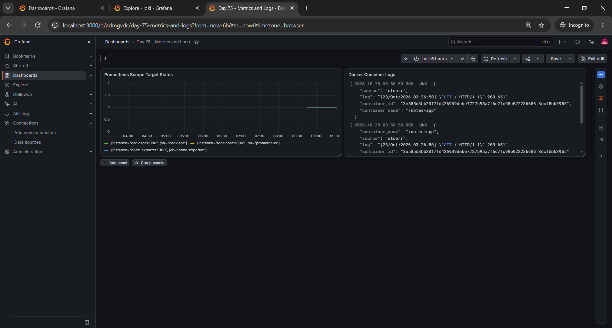

# Day 75: Loki and Promtail Logging Pipeline

## Overview

This project demonstrates a centralized logging pipeline for a Dockerized application using Fluent Bit, Loki, and Grafana. Docker container logs are forwarded through Fluent Bit to Loki and explored in Grafana.

## Architecture

```text
Dockerized Notes App
        |
        | Docker fluentd logging driver
        v
Fluent Bit (Forward input :24224)
        |
        | Loki output
        v
Loki (:3100)
        |
        v
Grafana (Explore and Dashboard)
```

## Components

| Component | Purpose |
|---|---|
| Docker Compose | Runs the application and observability services |
| Fluent Bit | Receives container logs and forwards them to Loki |
| Loki | Stores and indexes log labels for querying |
| Grafana | Queries and visualizes logs and Prometheus metrics |
| Prometheus | Provides the scrape-target status panel |

## Configuration

### Loki

The Loki configuration is in `loki/loki-config.yml`. The service exposes port `3100` and uses filesystem storage for this local learning project.

### Fluent Bit

The Fluent Bit configuration is in `fluent-bit/fluent-bit.conf`. It accepts Docker log records through the Forward protocol on port `24224` and sends them to Loki at `/loki/api/v1/push`.

### Docker log forwarding

The Notes App service uses Docker's `fluentd` logging driver to send logs to Fluent Bit. This was used because Docker Desktop's container log files were not available at the expected `/var/lib/docker/containers/` path from the WSL bind mount.

## Grafana Setup

- Add Loki as a data source with URL `http://loki:3100`.
- Save and test the data source.
- Use Explore to run LogQL queries.
- The dashboard is named **Day 75 - Metrics and Logs**.

## LogQL Queries Tested

Show Docker logs:

```logql
{job="docker"}
```

Filter logs containing `notes-app`:

```logql
{job="docker"} |= "notes-app"
```

Filter out lines containing `error`:

```logql
{job="docker"} != "error"
```

Count log entries over time:

```logql
sum(count_over_time({job="docker"}[5m]))
```

The `error` query returned no results in the selected time window; this was expected for the logs available during testing.

## Validation

Loki readiness check:

```bash
curl -s http://localhost:3100/ready
```

Expected response:

```text
ready
```

A query for `{job="docker"}` returned application request logs, including successful HTTP requests.

## Screenshots

The following images are stored in the `screenshots/` directory next to this Markdown file. GitHub renders them inline when these relative paths are used.

### 1. Loki Data Source Connected



### 2. Docker Logs in Grafana Explore



### 3. Notes App Logs



### 4. LogQL Negative Filter



### 5. LogQL Count Over Time



### 6. Day 75 Metrics and Logs Dashboard



## Loki vs. ELK

- Loki indexes labels rather than indexing every word in each log line.
- LogQL is used to select streams and filter log content.
- Grafana provides a single interface to explore logs and visualize metrics.

## Lessons Learned

- A centralized log pipeline makes container logs easier to search and troubleshoot.
- Docker Desktop/WSL filesystem boundaries can affect access to container log files.
- Using Docker's Fluentd logging driver with Fluent Bit provided a working log collection path for this environment.
- Relative Markdown image links must match the repository's directory structure and exact filenames.

## Completion Checklist

- [x] Loki starts and reports ready.
- [x] Fluent Bit receives and forwards Docker logs.
- [x] Grafana Loki data source is connected.
- [x] LogQL queries return expected results.
- [x] Metrics and logs dashboard created.
- [x] Screenshots captured and referenced using relative paths.
- [ ] Commit and push the documentation and screenshots.
