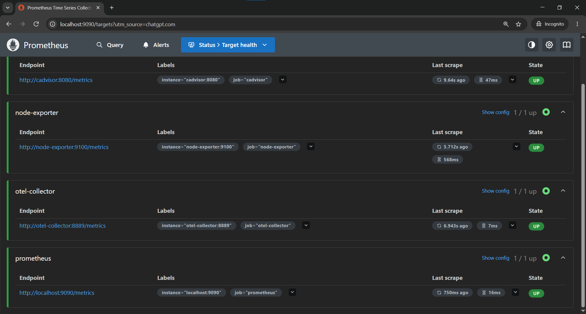
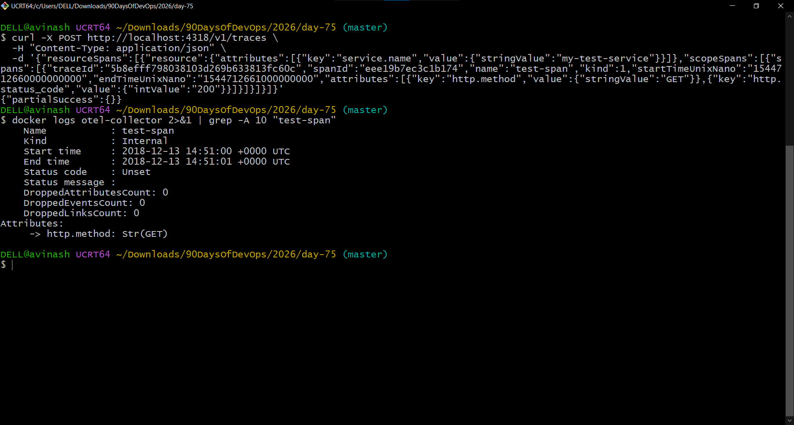
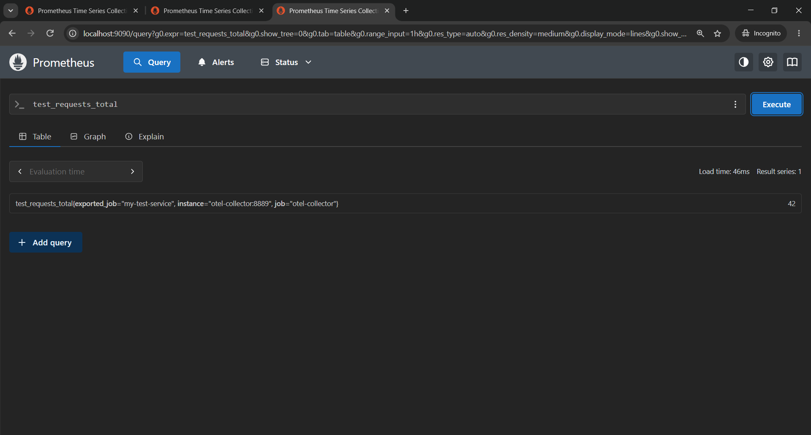
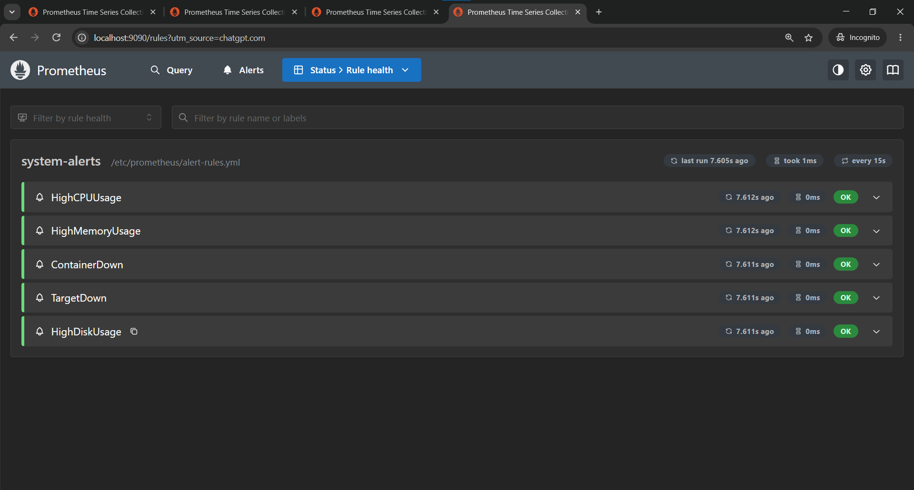
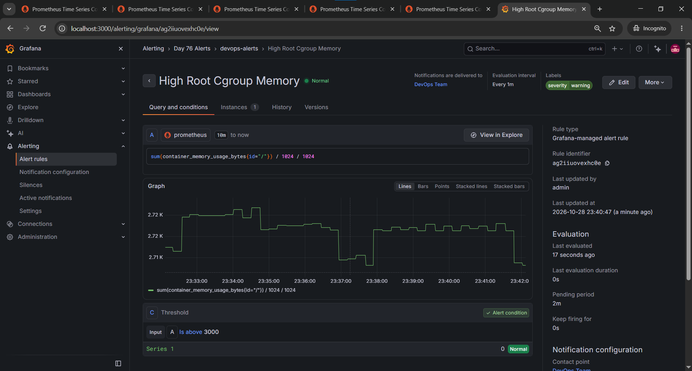

# Day 76: OpenTelemetry and Alerting

## Overview

For Day 76 of #90DaysOfDevOps, I added an OpenTelemetry Collector to the existing observability stack, verified OTLP trace and metric ingestion, and configured alert rules in Prometheus and Grafana.

> **Note:** The Day 76 work was implemented while the Docker Compose stack remained in `2026/day-75/`. This documentation and its screenshots are stored separately in `2026/day-76/`.

## Architecture

- **OpenTelemetry Collector** receives telemetry over OTLP.
- **Prometheus** scrapes the Collector's metrics endpoint.
- **Grafana** displays metrics and manages an alert rule.
- **cAdvisor** exposes container and cgroup metrics.
- **Prometheus alert rules** evaluate CPU, memory, target availability, container presence, and disk usage conditions.

## OpenTelemetry Collector configuration

File: `../day-75/otel-collector/otel-collector-config.yml`

```yaml
receivers:
  otlp:
    protocols:
      grpc:
        endpoint: 0.0.0.0:4317
      http:
        endpoint: 0.0.0.0:4318

processors:
  batch:

exporters:
  prometheus:
    endpoint: "0.0.0.0:8889"
  debug:
    verbosity: detailed

service:
  pipelines:
    metrics:
      receivers: [otlp]
      processors: [batch]
      exporters: [prometheus]
    traces:
      receivers: [otlp]
      processors: [batch]
      exporters: [debug]
    logs:
      receivers: [otlp]
      processors: [batch]
      exporters: [debug]
```

The Collector exposed OTLP gRPC on port `4317`, OTLP HTTP on `4318`, and a Prometheus metrics endpoint on `8889`.

## Prometheus integration

Prometheus was configured to scrape:

```yaml
- job_name: "otel-collector"
  static_configs:
    - targets: ["otel-collector:8889"]
```

Configuration validation completed successfully:

```text
SUCCESS: /etc/prometheus/prometheus.yml is valid prometheus config file syntax
SUCCESS: 5 rules found
```

## Verification

### 1. Collector target

The `otel-collector` target was visible as **UP** in Prometheus.



### 2. OTLP trace test

A test trace named `test-span` was sent to the Collector through the OTLP HTTP endpoint. The Collector logs showed the span, including the `http.method` attribute.



### 3. OTLP metric test

A test metric named `test_requests_total` was sent to the Collector. Prometheus returned a value of `42`, confirming the metrics path:

**OTLP → OpenTelemetry Collector → Prometheus**



## Prometheus alert rules

The `prometheus/alert-rules.yml` file contains five rules:

| Alert | Condition |
|---|---|
| `HighCPUUsage` | CPU usage above 80% for 2 minutes |
| `HighMemoryUsage` | Memory usage above 85% for 2 minutes |
| `ContainerDown` | `notes-app` container metric absent for 1 minute |
| `TargetDown` | A scrape target is down for 1 minute |
| `HighDiskUsage` | Root filesystem usage above 90% for 5 minutes |

Prometheus successfully loaded the rule group `system-alerts`, and all five rules showed **OK**.



## Grafana alerting

A Grafana contact point named `DevOps Team` was created and selected for the Grafana-managed alert rule.

The rule is named **High Root Cgroup Memory**. Its query is:

```promql
sum(container_memory_usage_bytes{id="/"}) / 1024 / 1024
```

The threshold is `3000` MiB, with a one-minute evaluation interval and a two-minute pending period. The rule showed **Normal** at the time of verification.

**Important limitation:** this query measures the root cAdvisor cgroup; it does not measure the `notes-app` container specifically. The rule name reflects that scope. The threshold is a lab value, not a production recommendation.



## Commands used for validation

```bash
docker compose config --quiet
docker compose up -d otel-collector
docker logs otel-collector --tail 20
```

On Git Bash for Windows, Prometheus configuration validation required disabling MSYS path conversion:

```bash
MSYS_NO_PATHCONV=1 docker compose exec prometheus promtool check config /etc/prometheus/prometheus.yml
```

## Key takeaways

- The OpenTelemetry Collector can receive telemetry over OTLP and expose metrics for Prometheus to scrape.
- Test traces and metrics are useful for verifying telemetry pipelines before connecting a real instrumented application.
- Prometheus rule files should be validated and confirmed in the Prometheus Rules UI.
- Grafana alert rules need a valid query, an evaluation group, a folder, and notification routing.
- Metric labels must be checked before writing an alert that targets a specific container.
- In this Docker Desktop environment, Promtail's expected host container-log path was not accessible as assumed; Docker's Fluentd logging driver and Fluent Bit were used for the Day 75 log pipeline instead.


